# Arquitectura C4 y Diagramas de Secuencia — QUIMERA

- **Documento:** `docs/04-architecture/C4.md`
- **Versión:** 1.0.0
- **Fecha:** 2026-11-21
- **Estado:** Consistente con `software-architecture.md`, `component-design.md` y `database-design.md`
- **Notación:** Mermaid (C4 Nivel 1, 2, 3, diagrama interno crítico y 9 diagramas de secuencia obligatorios).

---

## 1. C4 Nivel 1 — Diagrama de Contexto del Sistema (System Context)

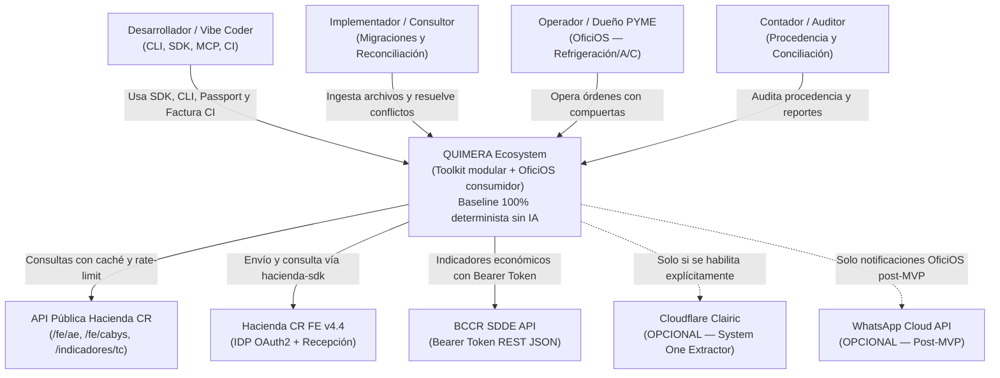

---

## 2. C4 Nivel 2 — Diagrama de Contenedores (Containers)

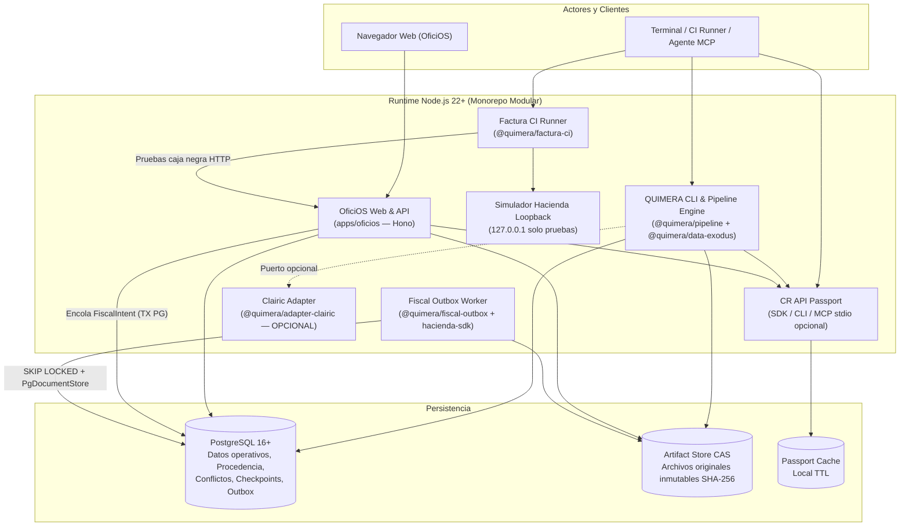

---

## 3. C4 Nivel 3 — Diagrama de Componentes Internos

### 3.1. Componentes de Data Exodus (`@quimera/data-exodus`)

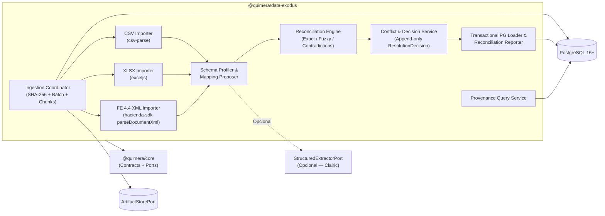

### 3.2. Componentes internos críticos: Fiscal Outbox + Factura CI

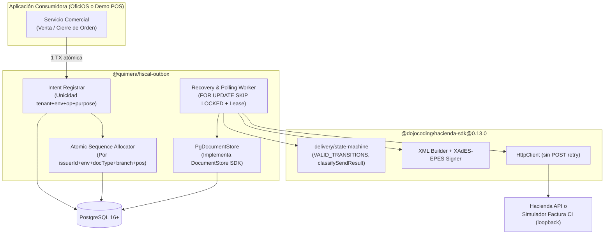

---

## 4. Diagramas de Secuencia Críticos (9 flujos obligatorios)

### 4.1. Secuencia 1 — Importación de datos (CSV / XLSX / XML FE 4.4)

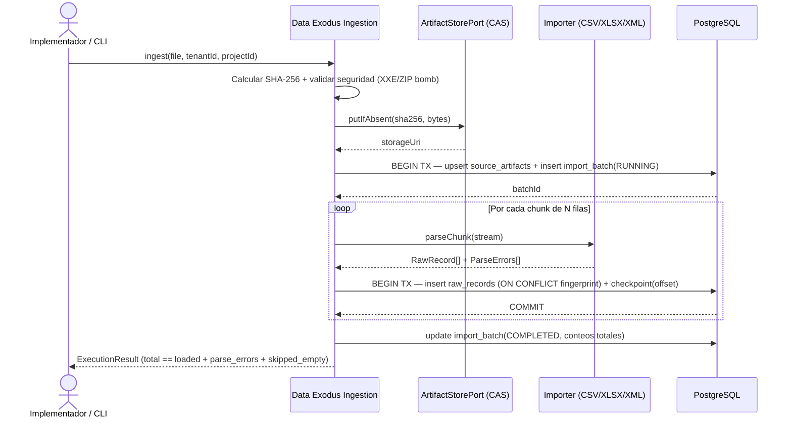

### 4.2. Secuencia 2 — Detección y resolución de duplicados

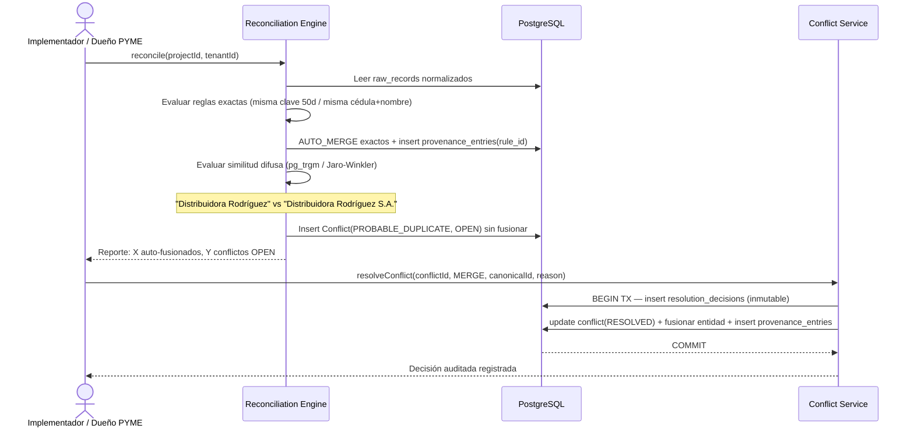

### 4.3. Secuencia 3 — Reconciliación de datos contradictorios (Cédula / Saldo irreconciliable)

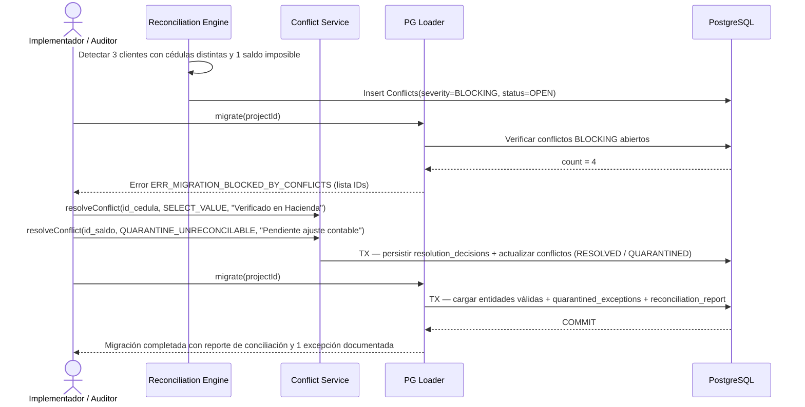

### 4.4. Secuencia 4 — Ejecución de pipeline con compuerta humana y reanudación

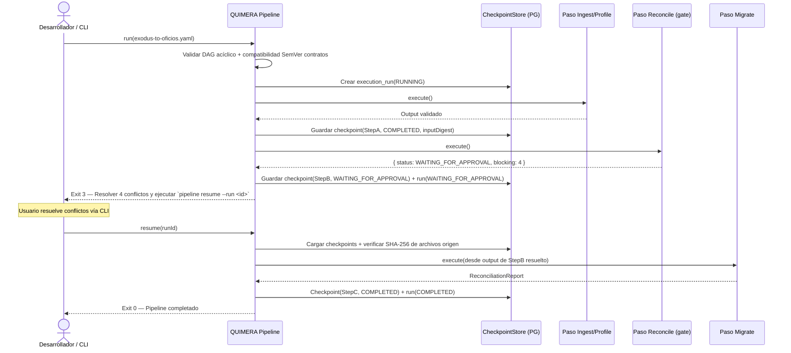

### 4.5. Secuencia 5 — Consulta de API externa y detección de deriva (CR API Passport)

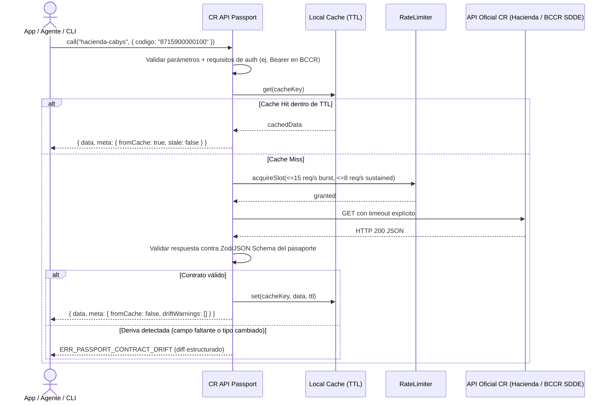

### 4.6. Secuencia 6 — Emisión fiscal simulada (Fiscal Outbox + Hacienda SDK)

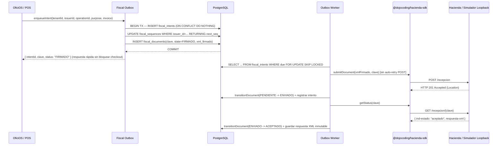

### 4.7. Secuencia 7 — Recuperación de un estado incierto (Timeout post-POST)

```mermaid
sequenceDiagram
    participant Wrk as Outbox Worker
    participant PG as PostgreSQL
    participant SDK as @dojocoding/hacienda-sdk
    participant Hac as Hacienda / Simulador

    Wrk->>PG: Registrar intento #1 ANTES del POST (clave = C1)
    Wrk->>SDK: submitDocument(xmlFirmado, clave = C1)
    SDK->>Hac: POST /recepcion (clave = C1)
    Note over Hac: Hacienda RECIBE C1 pero se corta la conexión TCP
    Hac--xSDK: Timeout / ECONNRESET
    SDK-->>Wrk: classifySendResult(error) => { type: "ambiguous", state: "PENDIENTE" }
    Note over Wrk: PROHIBIDO generar nueva clave o reenviar POST
    Wrk->>PG: Actualizar estado = AMBIGUOUS_RECONCILING, programar next_poll_at (backoff)
    Note over Wrk: Siguiente ciclo (o tras reinicio del proceso worker)
    Wrk->>SDK: getStatus(clave = C1)
    SDK->>Hac: GET /recepcion/C1
    alt Hacienda ya lo procesó
        Hac-->>SDK: { ind-estado: "aceptado", respuesta-xml }
        Wrk->>PG: transitionDocument(PENDIENTE -> ACEPTADO) + guardar respuesta
    else HTTP 404 inicial (aún no indexado)
        Hac-->>SDK: 404 Not Found
        Wrk->>PG: Mantener AMBIGUOUS_RECONCILING; reintentar GET hasta ventana máxima -> MANUAL_INTERVENTION
    end
```

### 4.8. Secuencia 8 — Ejecución de pruebas conductuales con Factura CI

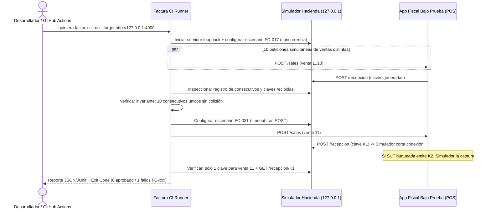

### 4.9. Secuencia 9 — Flujo completo de OficiOS (con bloqueo por falta de aprobación)

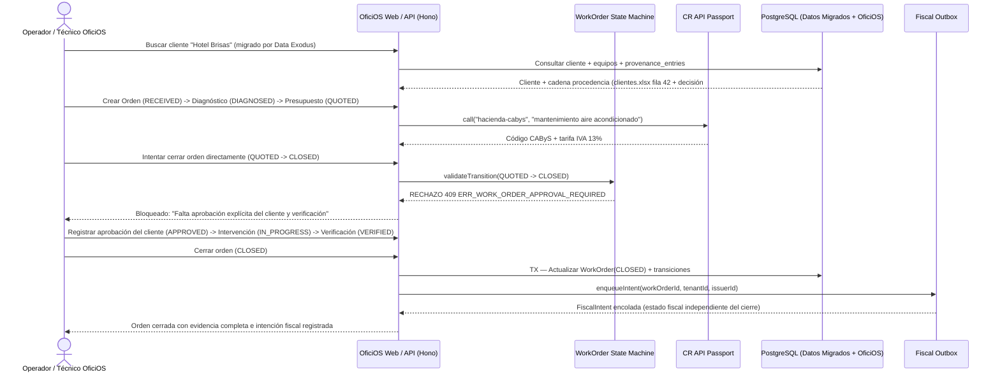
