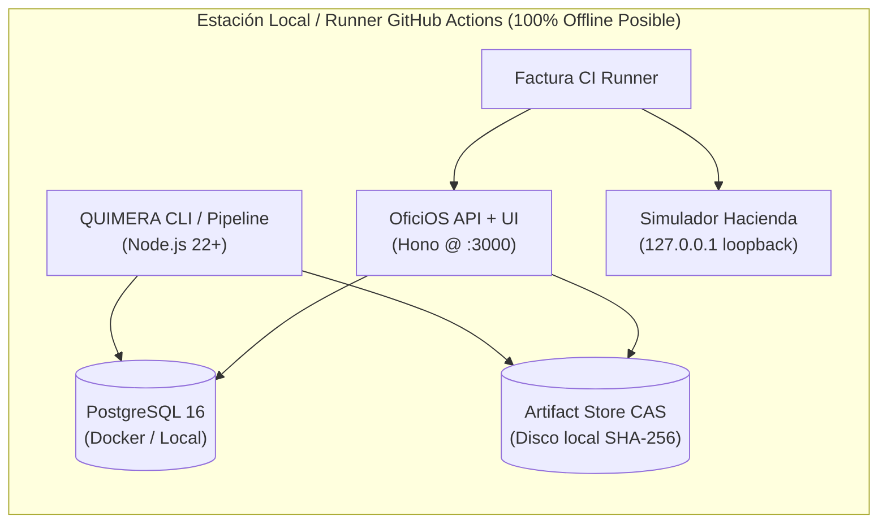
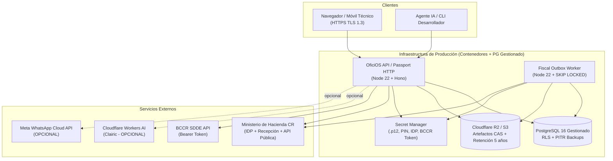

# Arquitectura de Despliegue — QUIMERA

- **Documento:** `docs/04-architecture/deployment-architecture.md`
- **Versión:** 1.0.0
- **Fecha:** 2026-11-21
- **Estado:** Aprobado para MVP y evolución a producción
- **ADR relacionado:** [`ADR-013`](./ADR/ADR-013-deployment-strategy.md)

---

## 1. Perfiles de despliegue

QUIMERA distingue explícitamente **tres topologías de despliegue** para evitar que la infraestructura de producción entorpezca el MVP local o la ejecución en CI.

### Perfil 1 — Local Developer / Hackathon Demo / CI (MVP Obligatorio)
- **Requisitos:** Node.js 22.13+, `pnpm`, Docker (solo para PostgreSQL 16) o PostgreSQL 16 local.
- **Almacenamiento de artefactos:** Directorio local content-addressed (`./.quimera-store/sha256/...`).
- **Servicios externos:** **Cero requeridos** en modo demo/CI (`CR API Passport` en `--mode fixture`, `Factura CI` contra simulador loopback `127.0.0.1`, `Clairic` desinstalado/desactivado).
- **Arranque reproducible:** `docker compose up -d postgres && pnpm db:migrate && pnpm demo:e2e`.

### Perfil 2 — Producción PYME / Agencia (Post-Hackathon / Pilotos)
- **Computo:** Contenedor Docker único (o 2 contenedores: `oficios-api` + `fiscal-outbox-worker`) en VPS/Fly.io/Railway/Render con Node.js 22 LTS.
- **Base de datos:** PostgreSQL 16+ gestionado (ej. Supabase, Neon o RDS) con TLS obligatorio, backups diarios PITR (Point-in-Time Recovery) y RLS habilitado por `tenant_id`.
- **Almacenamiento de evidencia:** Bucket compatible S3 / Cloudflare R2 con versionado y política de retención WORM/Object Lock (5 años para XML fiscales y evidencia documental).
- **Secretos:** Variables de entorno inyectadas desde Secret Manager (nunca archivos `.env` ni `.p12` dentro de imágenes Docker; certificados `.p12` montados desde volumen cifrado o almacén de secretos).
- **Conectividad saliente:**
  - `api.hacienda.go.cr` (vía `CR API Passport` con caché compartida y rate limiter).
  - `api.comprobanteselectronicos.go.cr` / IDP Hacienda (vía `Fiscal Outbox` + `@dojocoding/hacienda-sdk`).
  - `apim.bccr.fi.cr/SDDE/...` (con `BCCR_SDDE_TOKEN` gestionado).
  - Opcional: Cloudflare Workers AI (`@cf/cloudflare/clairic`) y Meta WhatsApp Cloud API (`@dojocoding/whatsapp-sdk`).

### Perfil 3 — Extensión Edge / Cloudflare (Evaluación futura post-Beta)
- **¿Por qué NO desplegar todo en Cloudflare Workers en el MVP?**
  1. `@dojocoding/hacienda-sdk` depende de `node-forge`, `xadesjs`, `xmllint-wasm` y `Node.js 22+`; ejecutar firma XAdES-EPES y validación XSD completa en V8 isolates introduce fricción de compatibilidad no trivial.
  2. Cloudflare Queues entrega mensajes **at-least-once** (sin garantía de orden ni deduplicación automática) y Cloudflare Workflows limita resultados de paso a 1 MiB y exige idempotencia externa de todas formas.
  3. El baseline de QUIMERA debe ejecutarse localmente sin dependencia de cuenta cloud.
- **Dónde SÍ encaja Cloudflare en fase futura:**
  - **Cloudflare R2** como adaptador S3-compatible de `ArtifactStorePort` (cero cargos de egress).
  - **Cloudflare Workers** para alojar instancias públicas/stateless de `CR API Passport` (HTTP + MCP `2026-07-28` stateless) usando `Hono`.
  - **Cloudflare Workflows / Durable Objects** como adaptador alternativo de `OutboxSchedulerPort` para orquestar polling prolongado de estados o rate limiting global multi-réplica cuando el volumen supere un worker PostgreSQL simple.
  - **Cloudflare Workers AI (`@cf/cloudflare/clairic`)** como backend HTTP opcional de `@quimera/adapter-clairic`.

---

## 2. Requisitos operativos de respaldo y recuperación

| Recurso | Estrategia MVP | Estrategia Producción | RPO / RTO objetivo `[HIPÓTESIS]` |
|---|---|---|---|
| PostgreSQL (datos operativos, procedencia, outbox) | Volumen Docker + `pg_dump` scriptable | Backups automáticos diarios + WAL archiving (PITR) | RPO ≤ 5 min / RTO ≤ 30 min |
| `ArtifactStorePort` (archivos originales + XML firmados) | Carpeta CAS local con verificación SHA-256 | R2/S3 con replicación + retención 5 años (1.825 días) | RPO = 0 (escritura sincrónica antes de ACK) |
| Secretos y `.p12` | Variables de entorno locales (`.env` en `.gitignore`) | Secret Manager con rotación y auditoría de acceso | N/A (fuera de repo y backups planos) |
