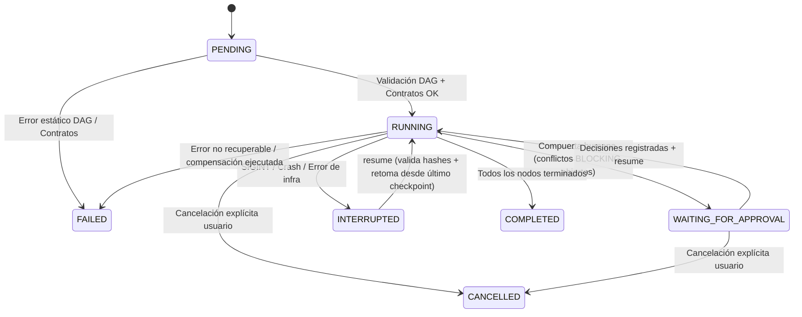

# Arquitectura de Pipelines — QUIMERA Pipeline

- **Documento:** `docs/04-architecture/pipeline-architecture.md`
- **Versión:** 1.0.0
- **Fecha:** 2026-11-21
- **Estado:** Aprobado para implementación (`@quimera/pipeline`)
- **ADR relacionado:** [`ADR-008`](./ADR/ADR-008-pipeline-design.md)

---

## 1. Modelo de ejecución: DAG acíclico determinista vs. pipeline lineal

Se elige un **DAG (Grafo Acíclico Dirigido) ligero** sobre un pipeline estrictamente lineal porque el flujo real de `Data Exodus` presenta ramas naturalmente independientes (por ejemplo: ingestar `clientes.xlsx`, `ventas_2025.csv` y `facturas/*.xml` en paralelo o en cualquier orden antes de converger en `profile` y `reconcile`, y después bifurcar hacia `migrate` y `passport-enrich`).

- **Límite de complejidad intencional:** El DAG se representa como un manifiesto YAML/JSON declarativo con pasos pre-registrados (`StepRegistry`), ejecutado en el mismo proceso Node.js 22 (sin scheduler distribuido, sin colas Kafka y sin ejecución de código arbitrario embebido).
- **Ordenamiento topológico:** Validado antes del paso 1 mediante algoritmo de Kahn; cualquier ciclo o referencia inexistente aborta con `ERR_PIPELINE_INVALID_DAG`.

---

## 2. Garantías de entrega: por qué NO prometemos «exactly-once»

> **Principio normativo (`AP-06`):** En presencia de fallos de proceso, cortes de energía o redes no confiables, ningún motor de pipelines puede garantizar semántica *exactly-once* de extremo a extremo hacia efectos externos sin coordinación transaccional con el receptor.

QUIMERA Pipeline garantiza **ejecución `at-least-once` con idempotencia verificada en pasos locales y reconciliación explícita en pasos con efectos externos**:

| Propiedad del paso | Política del motor | Ejemplo en QUIMERA |
|---|---|---|
| `idempotent: true` + `sideEffects: "database_tx"` | Reintento automático permitido con backoff exponencial acotado (`maxRetries <= 3`) si `error.retryable === true`; idempotencia asegurada por claves únicas/fingerprints en PostgreSQL. | `exodus.ingest`, `exodus.profile`, `exodus.reconcile`, `exodus.migrate` |
| `idempotent: true` + `sideEffects: "read_only_external"` | Reintento controlado sujeto al `RateLimiter` del pasaporte y respeto a `Retry-After`. | `passport.lookup_cabys`, `passport.lookup_taxpayer` |
| `idempotent: false` + `sideEffects: "external_mutation"` | **Prohibido reintentar automáticamente ante timeout/5xx.** El paso falla a estado `AMBIGUOUS` y delega en una ruta explícita de reconciliación (ej. consulta por `clave` en `Fiscal Outbox`). | `fiscal.submit_hacienda` |

---

## 3. Ciclo de vida, Checkpoints, Cancelación y Reanudación



### 3.1. Checkpoints atómicos
Al finalizar cada paso `S`, el motor escribe dentro de PostgreSQL un registro `checkpoints`:
- `run_id`, `step_id`, `attempt_number`, `status` (`COMPLETED`, `WAITING_FOR_APPROVAL`, `FAILED`).
- `input_digest` (`SHA-256` de los parámetros y artefactos de entrada del paso).
- `output_ref` (referencia serializada JSONB a los IDs/artefactos producidos por el paso, validada contra `outputContract`).
- `cursor_state` (opcional para pasos batch por chunks, ej. `lastCommittedRow: 500`).

### 3.2. Reanudación segura (`pipeline resume --run <runId>`)
1. Carga el `ExecutionRun` y todos los `checkpoints` en estado `COMPLETED`.
2. Recalcula el `input_digest` de los artefactos fuente; si algún archivo origen fue modificado en disco tras el fallo, **aborta con `ERR_ARTIFACT_HASH_MISMATCH`** para impedir mezcla de versiones.
3. Omite todos los pasos ya confirmados en `COMPLETED` pasando sus `output_ref` persistidos a los pasos descendientes.
4. Si un paso batch quedó a la mitad (`cursor_state`), retoma desde `lastCommittedRow + 1` con escrituras `ON CONFLICT`.

### 3.3. Cancelación limpia
Al recibir `SIGINT`/`SIGTERM` o `AbortSignal`:
- Detiene el lanzamiento de nuevos nodos del DAG.
- Propaga el `AbortSignal` al paso activo para que aborte su transacción en curso sin dejar escrituras parciales.
- Marca la corrida como `INTERRUPTED` (si fue señal de proceso) o `CANCELLED` (si fue cancelación explícita del usuario).

---

## 4. Verificación estática de compatibilidad de contratos

Cada paso registrado en `StepRegistry` declara:
```ts
export interface PipelineStepDescriptor<TIn, TOut> {
  stepId: string;
  version: string; // SemVer
  inputContract: { name: string; semver: string; schema: z.ZodType<TIn> };
  outputContract: { name: string; semver: string; schema: z.ZodType<TOut> };
  idempotent: boolean;
  requiresHumanGate?: boolean;
  execute(input: TIn, ctx: StepExecutionContext): Promise<TOut>;
  compensate?(input: TIn, partialOutput: unknown, ctx: StepExecutionContext): Promise<void>;
}
```
Antes de ejecutar el primer nodo, el planificador verifica para cada arista `A → B`:
1. `A.outputContract.name === B.inputContract.name` (o existe un adaptador explícito declarado en la arista).
2. Compatibilidad SemVer: mismo `MAJOR` y `A.outputContract.MINOR >= B.inputContract.MIN_REQUIRED_MINOR`.
3. En tiempo de ejecución, el output real de `A` se valida contra `A.outputContract.schema` antes de persistir el checkpoint.

---

## 5. Compuertas de revisión humana (`human_review`) y Compensaciones

- **Compuerta humana:** Un nodo como `exodus.reconcile` puede retornar `{ status: "WAITING_FOR_APPROVAL", blockingConflicts: 14 }`. El motor pausa el DAG en `WAITING_FOR_APPROVAL`, imprime el resumen y los comandos exactos para inspeccionar y resolver conflictos, y termina el proceso CLI con código de salida dedicado (`exit code 3 — acción humana requerida`) en lugar de fallar con error genérico. Una vez resueltos (o marcados en cuarentena) los conflictos bloqueantes, `quimera pipeline resume --run <id>` continúa automáticamente hacia `exodus.migrate`.
- **Compensaciones:** Si un paso posterior con efectos reversibles falla irremediablemente y el manifiesto activa `onFailure: compensate`, el motor invoca `compensate()` en orden topológico inverso solo para los pasos que declaran compensador, registrando cada resultado en `execution_runs`. Los pasos `append-only` de evidencia (`source_artifacts`, `provenance_entries`) **nunca se borran** en compensaciones; solo se marcan como pertenecientes a una corrida compensada.

---

## 6. Ejemplo de manifiesto declarativo (`pipelines/exodus-to-oficios.yaml`)

```yaml
pipelineSpecVersion: "1.0"
id: exodus-to-oficios-mvp
description: "Ingestión multi-formato, reconciliación asistida, migración a PostgreSQL y verificación"
steps:
  - id: ingest_csv
    uses: exodus.ingest@1.0.0
    inputs:
      format: csv
      glob: "./fixtures/demo-7files/*.csv"
  - id: ingest_xlsx
    uses: exodus.ingest@1.0.0
    inputs:
      format: xlsx
      glob: "./fixtures/demo-7files/*.xlsx"
  - id: ingest_xml
    uses: exodus.ingest@1.0.0
    inputs:
      format: hacienda-xml
      glob: "./fixtures/demo-7files/xml/*.xml"
  - id: profile
    uses: exodus.profile@1.0.0
    dependsOn: [ingest_csv, ingest_xlsx, ingest_xml]
  - id: reconcile
    uses: exodus.reconcile@1.0.0
    dependsOn: [profile]
    gate: human_review
  - id: migrate
    uses: exodus.migrate@1.0.0
    dependsOn: [reconcile]
    inputs:
      targetSchema: "oficios-v1"
```
