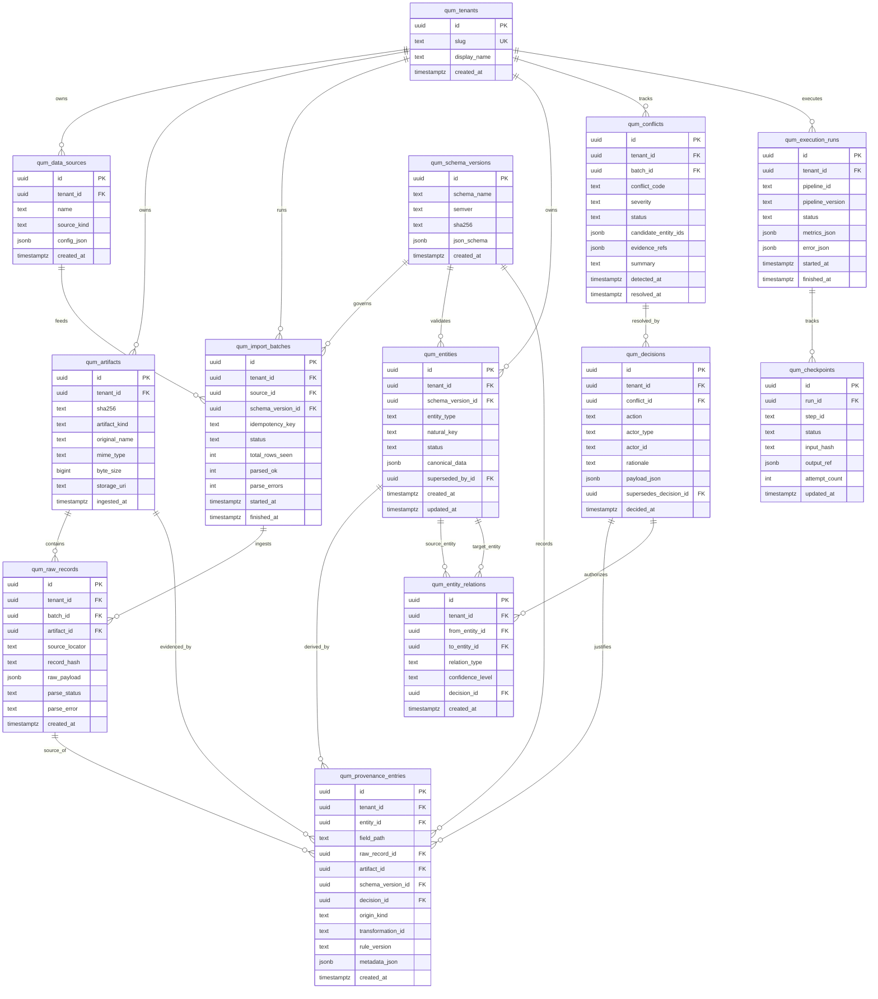
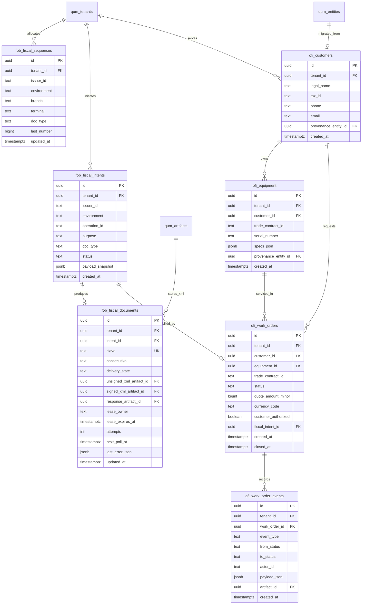

# Diagrama Entidad-Relación (ERD) — QUIMERA

- **Versión:** 1.0.0
- **Fecha:** 2026-11-21
- **Estado:** Propuesto para implementación MVP
- **Referencias:** [Modelo de Dominio](./domain-model.md) | [Diseño de Base de Datos](./database-design.md)

---

## 1. ERD del Núcleo, Data Exodus y Pipelines (`qum_*`)

---

## 2. ERD de Fiscal Outbox (`fob_*`) y OficiOS (`ofi_*`)

Las tablas `fob_*` y `ofi_*` son independientes del núcleo (`ADR-010`, `ADR-011`) y solo referencian hacia `qum_tenants`, `qum_artifacts` y `qum_entities` de forma opcional y unidireccional.

