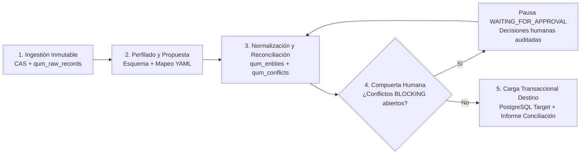

# Estrategia de Migración de Datos, Integridad e Idempotencia — QUIMERA

- **Versión:** 1.0.0
- **Fecha:** 2026-11-21
- **Estado:** Propuesto para implementación MVP
- **Referencias:** [Diseño de Base de Datos](./database-design.md) | [Modelo de Reconciliación](./reconciliation-model.md) | [Arquitectura de Pipelines](../04-architecture/pipeline-architecture.md)

---

## 1. Flujo de Migración en 5 Etapas (Extract → Stage → Reconcile → Gate → Load)

### Reglas por Etapa
1. **Ingestión Inmutable:** Nunca modifica archivos fuente. Calcula `SHA-256` por archivo y por fila, guarda el binario en CAS y registra `qum_import_batches` + `qum_raw_records` en una transacción atómica.
2. **Perfilado y Mapeo:** Infiere tipos, codificaciones (UTF-8 / Windows-1252 / BOM), formatos de fecha, monedas y llaves candidatas; produce un `mapping.yaml` editable y versionable.
3. **Normalización y Reconciliación:** Aplica transformadores deterministas y ejecuta las 10 reglas de detección de conflictos (`reconciliation-model.md`).
4. **Compuerta Humana:** Por defecto, si `count(conflicts WHERE severity = 'BLOCKING' AND status = 'OPEN') > 0`, la carga destino se bloquea. Modo `--allow-partial-quarantine` (opcional explícito) carga únicamente entidades `VERIFIED` y deja las `BLOCKED` en cuarentena documentada.
5. **Carga Transaccional Destino:** Inserta/actualiza entidades verificadas en el esquema destino (ej. `ofi_customers`, `ofi_equipment`) dentro de transacciones idempotentes (`ON CONFLICT` por llave natural / `provenance_entity_id`) y emite un **Informe de Conciliación** verificable.

---

## 2. Garantías de Integridad e Idempotencia (Las 7 Fallas Prohibidas)

| Falla a evitar | Mecanismo concreto en QUIMERA | Prueba asociada |
|---|---|---|
| **1. Importaciones duplicadas** | `qum_import_batches` exige `UNIQUE (tenant_id, idempotency_key)` donde `idempotency_key = sha256(source_id + sorted(artifact_sha256) + mapping_sha256 + schema_version)`. Re-ejecutar con los mismos insumos retorna el lote existente (`NOOP`) sin insertar filas nuevas. | `T-DATA-008` |
| **2. Escrituras parciales** | Cada paso del pipeline escribe en PostgreSQL dentro de `BEGIN ... COMMIT` junto con su actualización de `qum_checkpoints`. Si el proceso muere a mitad de carga, PostgreSQL hace `ROLLBACK` automático y el checkpoint permanece en el paso anterior. | `T-DATA-012` |
| **3. Mezcla de datos entre empresas** | `tenant_id NOT NULL` en toda tabla + claves únicas compuestas con `tenant_id` + RLS (`FORCE ROW LEVEL SECURITY`) + validación en runtime que rechaza cualquier enlace entre entidades con distinto `tenant_id`. | `T-SEC-001` |
| **4. Pérdida silenciosa de registros** | Invariante aritmética verificada al final de cada etapa: `raw_seen == parsed_ok + parse_errors + skipped_empty`, y en carga: `entities_eligible == entities_loaded + entities_quarantined + entities_rejected_by_decision`. Si no cuadra, el lote falla con error `ERR_DATA_COUNT_MISMATCH`. | `T-DATA-001` |
| **5. Transformaciones no reproducibles** | Prohibido usar funciones no deterministas (`Math.random()`, `Date.now()` como valor de negocio, LLM sin semilla/decisión) en reglas de transformación. Cada regla se identifica por `transformation_id@semver` y sus parámetros se guardan en `qum_provenance_entries`. | `T-DATA-005` |
| **6. Referencias sin origen** | Restricciones `FOREIGN KEY` estrictas en PostgreSQL + regla `ORPHAN_RECORD` que impide crear relaciones hacia entidades no presentes o no verificadas. | `T-DATA-006` |
| **7. Relaciones creadas por inferencias no verificadas** | Restricción `CHECK (confidence_level IN ('EXACT','RULE_VERIFIED','HUMAN_APPROVED'))` en `qum_entity_relations` y regla de dominio que exige `decision_id NOT NULL` cuando `confidence_level = 'HUMAN_APPROVED'`. Las sugerencias heurísticas o de IA se almacenan solo como `Conflict`, jamás como `EntityRelation`. | `T-DATA-006`, `T-CLAI-002` |

---

## 3. Estrategia de Dry-Run, Cuarentena y Rollback

- **Dry-Run obligatorio previo (`--dry-run`):** Ejecuta etapas 1 a 3 en modo simulación o dentro de transacción con rollback final, generando el reporte completo de esquema propuesto, conteos estimados y conflictos sin escribir en las tablas destino del negocio.
- **Cuarentena explícita:** Las filas que fallan parseo (`parse_status = 'ERROR'`) o entidades con conflictos `UNRECONCILABLE` permanecen en `qum_raw_records` / `qum_entities(status='BLOCKED')` y aparecen listadas en el informe final con su causa exacta.
- **Reversión controlada (compensación):** Cada carga destino registra el `import_batch_id` asociado. Si el operador decide revertir una migración recién aplicada (antes de que ocurran transacciones operativas posteriores sobre esos registros), una acción de compensación elimina los registros del `target` ligados exclusivamente a ese `batch_id` sin tocar `qum_artifacts` ni `qum_decisions`.

---

## 4. Informe de Conciliación Post-Migración

Al finalizar toda migración, `Data Exodus` genera un artefacto JSON (guardado en CAS con `artifact_kind = 'reconciliation_report'`) y su vista Markdown resumida que incluye:
1. Metadatos del lote (`batch_id`, `tenant_id`, `schema_version`, hashes de archivos fuente).
2. Balance de filas por archivo (`seen`, `parsed_ok`, `parse_errors`, `skipped_empty`).
3. Resumen de entidades reconstruidas por tipo (`customer`, `invoice`, `payment`, etc.).
4. Resumen de conflictos (`detected`, `auto_resolved_exact`, `resolved_human`, `unreconcilable`, `open_quarantined`).
5. Verificación de totales monetarios por moneda (`CRC`, `USD`): suma de facturas/pagos antes vs después de migración, explicando cada diferencia con sus `decision_id` o `conflict_id`.
