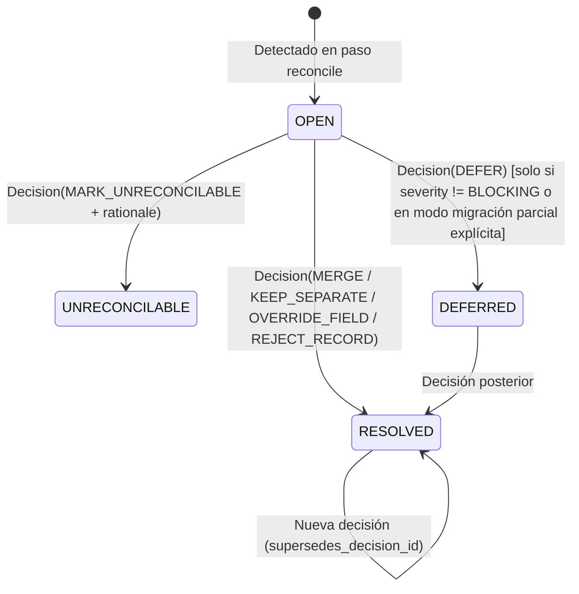

# Modelo de Reconciliación y Manejo de Conflictos — QUIMERA

- **Versión:** 1.0.0
- **Fecha:** 2026-11-21
- **Estado:** Propuesto para implementación MVP
- **Referencias:** [ADR-006](../04-architecture/ADR/ADR-006-conflict-reconciliation-model.md) | [Modelo de Dominio](./domain-model.md) | [Casos de Uso UC-06, UC-07](../02-product/use-cases.md)

---

## 1. Filosofía de Reconciliación

La reconciliación en QUIMERA parte de una regla conservadora:

> **Preferir un conflicto visible y revisable antes que una fusión silenciosa incorrecta.**

Los agentes de IA y scripts ad-hoc suelen "arreglar" datos sucios aplicando heurísticas agresivas (como unir cualquier par de clientes con Levenshtein < 3 o descartar filas con fechas raras). En negocios reales, eso destruye cuentas por cobrar, mezcla cédulas y corrompe contabilidad.

QUIMERA separa estrictamente:
- **Reglas automáticas deterministas** (solo cuando existe equivalencia exacta verificable y cero ambigüedad).
- **Detección + compuerta de revisión humana** (cuando existe similitud probabilística, contradicción de valores, incoherencia financiera o referencia rota).

---

## 2. Taxonomía de las 10 Estrategias de Reconciliación

| # | Código | Escenario | Detección | ¿Automatizable? | Acción por defecto |
|---|---|---|---|---|---|
| 1 | `EXACT_DUPLICATE` | **Duplicados exactos** (mismo `record_hash`, misma clave numérica de 50 dígitos de Hacienda o misma cédula + mismos campos normalizados) | Hash SHA-256 canónico o clave primaria fiscal (`clave`) | **Sí (determinista)** | Consolida en 1 entidad canónica y adjunta **todas** las `ProvenanceEntry` de los orígenes. Registra `Conflict` informativo (`INFO`, auto-resuelto con `actor_type=RULE`). |
| 2 | `PROBABLE_DUPLICATE` | **Duplicados probables** (ej. «Distribuidora Rodríguez» vs «Distribuidora Rodríguez S.A.» sin cédula en uno de los archivos) | Normalización de razón social (remoción de sufijos legales `S.A.`, `S.R.L.`, `Ltda.`, tildes, puntuación) + similitud Jaro-Winkler ≥ 0.88 o coincidencia de teléfono/correo | **No** | Crea `Conflict` **`BLOCKING`** con candidatos lado a lado. Exige decisión humana: `MERGE` (eligiendo registro maestro) o `KEEP_SEPARATE`. |
| 3 | `CONFLICTING_IDENTITY` | **Identidades conflictivas** (mismo nombre/clave de cliente pero dos cédulas jurídicas/físicas distintas, o misma cédula con dos razones sociales incompatibles) | Cruce por identificador natural vs `tax_id` (y validación opcional contra `/fe/ae` de Hacienda) | **No** | Crea `Conflict` **`BLOCKING`**. Bloquea migración de esas entidades hasta decisión `KEEP_SEPARATE` u `OVERRIDE_FIELD` con evidencia. |
| 4 | `MONETARY_MISMATCH` | **Valores monetarios incompatibles** (ej. factura XML dice `₡120.000`, Excel de ventas dice `₡115.000`; o pago aparece como abono en una hoja y venta completa en otra) | Comparación exacta en unidades menores enteras entre fuentes vinculadas por número de factura/consecutivo | **No** | Crea `Conflict` **`BLOCKING`**. Presenta prioridad sugerida (ej. FE XML aceptada por Hacienda > hoja Excel) pero exige aprobación humana explícita. |
| 5 | `MISSING_REQUIRED_DATA` | **Datos faltantes** (campo requerido por `TargetSchema` nulo/vacío, ej. cliente sin teléfono ni correo o factura sin fecha) | Validación Zod contra esquema destino | **Solo si hay default declarado explícitamente en esquema**; si no, **No** | Si es campo obligatorio sin default: `Conflict` **`BLOCKING`** (`OVERRIDE_FIELD` o `REJECT_RECORD`). Si es opcional: `WARNING` documentado. |
| 6 | `ORPHAN_RECORD` | **Registros huérfanos** (ej. pago o línea de detalle que referencia un cliente o factura inexistente en el lote) | Integridad referencial previa a la carga destino | **No** | Crea `Conflict` **`BLOCKING`**; no se crea entidad padre inventada ni se descarta silenciosamente el registro. |
| 7 | `INVALID_REFERENCE` | **Referencias inválidas** (ej. código CAByS inexistente o formato de cédula CR inválido, o pago vinculado a un cliente equivocado según cédula de la factura) | Validación de formato + cruce contra catálogo CAByS / entidades válidas | **No** | Crea `Conflict` **`BLOCKING`** con detalle de la referencia esperada vs encontrada. |
| 8 | `TEMPORAL_ANOMALY` | **Errores de temporalidad** (ej. fecha de pago anterior a emisión de factura, fecha futura imposible, formato ambiguo `04/05/2025` cuando el archivo mezcla `DD/MM/YYYY` y `MM/DD/YYYY`) | Validación de monotonicidad temporal y detector de ambigüedad de formato de fecha por columna | **Solo si formato de fecha del origen está declarado explícitamente**; si es ambiguo o viola orden lógico: **No** | Crea `Conflict` **`BLOCKING`** (ambigüedad de formato o inconsistencia cronológica fuerte) o **`WARNING`** (desfase menor explicable como anticipo). |
| 9 | `UNIT_OR_CURRENCY_MISMATCH` | **Cambios de unidades y monedas** (ej. una hoja registra en `USD` sin símbolo y otra en `CRC`, o cantidades en cajas vs unidades) | Detector de símbolos (`₡`, `$`, `CRC`, `USD`), magnitud atípica (>10x desviación estándar) y metadatos de unidad | **Solo si moneda y tipo de cambio oficial (Hacienda/BCCR) están declarados explícitamente**; nunca convertir monedas implícitamente | Crea `Conflict` **`BLOCKING`**. Prohíbe sumar `CRC` + `USD` sin tasa explícita y trazada. |
| 10 | `UNRECONCILABLE_BALANCE` | **Datos imposibles de reconciliar** (ej. suma de pagos excede el total de facturas sin nota de crédito, o saldo histórico declarado no cierra contra movimientos existentes) | Verificación de invariante contable (`saldo_declarado == facturas - notas_credito - pagos`) | **No** | Crea `Conflict` **`BLOCKING`**. Puede cerrarse únicamente mediante `MARK_UNRECONCILABLE` (registro en libro de excepciones con `rationale` obligatorio) o ingresando documento faltante en un nuevo lote. |

---

## 3. Reglas de Automatización vs Revisión Humana

### Cuándo se permite automatización (`actor_type = RULE`)
Únicamente si se cumplen **todas** estas condiciones:
1. Regla puramente determinista y versionada (`rule_version`).
2. Equivalencia exacta (ej. `SHA-256` idéntico o `clave` de 50 dígitos de Hacienda idéntica sin contradicción de montos).
3. Cero pérdida de información (todos los orígenes quedan registrados en `qum_provenance_entries`).
4. Política del lote no restringe la auto-resolución (`autoResolveExactDuplicates: true`).

### Cuándo es OBLIGATORIA la revisión humana (`actor_type = HUMAN`)
Siempre que ocurra cualquiera de las siguientes:
- Similitud aproximada (*fuzzy matching*) de nombres, direcciones o descripciones.
- Dos fuentes contradicen un identificador legal (`tax_id`), un monto monetario o una fecha clave.
- Un dato proviene de extracción probabilística IA (`origin_kind = AI_EXTRACTION`) con `confidence < 0.90`, `p_null > 0.15`, `complete = false` o afecta campos fiscales/monetarios (`QR-CLAI-004`).
- Se pretende descartar un registro (`REJECT_RECORD`) o marcar un saldo como `UNRECONCILABLE`.

---

## 4. Ciclo de Vida de un Conflicto y Reproducibilidad

### Repetibilidad de Decisiones en Re-importaciones
Cada `ResolutionDecision` almacena una firma de contexto (`conflict_fingerprint` basado en `conflict_code` + hashes ordenados de los registros involucrados). Si el usuario re-importa los mismos archivos actualizados (UC-08):
- Los conflictos ya resueltos cuya evidencia **no cambió** pueden reaplicar automáticamente la decisión humana previa (registrando referencia a la decisión original).
- Si alguno de los registros involucrados cambió de hash, el conflicto se reabre como `OPEN` exigiendo nueva confirmación.

---

## 5. Verificación sobre el Dataset Sintético de Demostración (1.000 Registros)

El dataset de demo documentado en el brief de QUIMERA sirve como prueba de aceptación directa (`T-DATA-006` / `AT-06`):
- **40 clientes repetidos bajo distintos nombres** → detectados como `PROBABLE_DUPLICATE` (ninguno fusionado sin decisión).
- **12 facturas duplicadas** → detectadas como `EXACT_DUPLICATE` (si clave/hash idénticos) o `MONETARY_MISMATCH` (si difieren montos).
- **7 pagos atribuidos incorrectamente** → detectados como `INVALID_REFERENCE` / `ORPHAN_RECORD` / `MONETARY_MISMATCH`.
- **3 clientes con cédulas contradictorias** → detectados como `CONFLICTING_IDENTITY` (`BLOCKING`).
- **1 saldo imposible de reconciliar** → detectado como `UNRECONCILABLE_BALANCE` (`BLOCKING`), reflejado explícitamente en el informe de excepciones.
