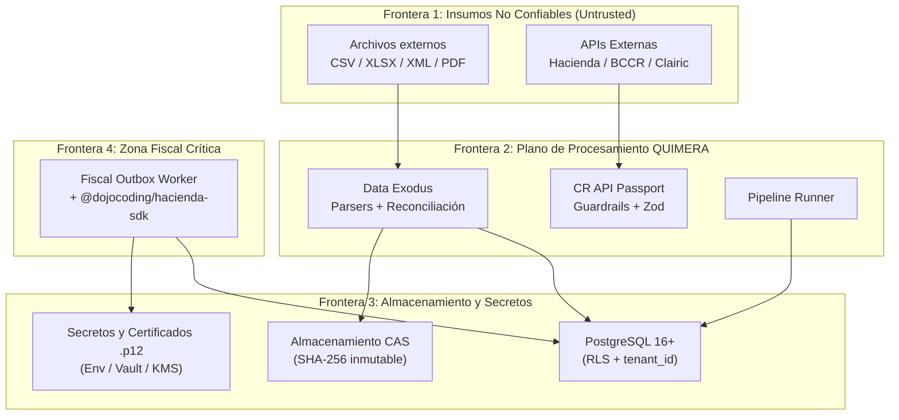

# Modelo de Amenazas (STRIDE + OWASP) — QUIMERA

- **Versión:** 1.0.1
- **Fecha:** 2026-11-21
- **Estado:** Alineado con `requirements-catalog.md` v1.0.0
- **Referencias:** [Requisitos de Seguridad](./security-requirements.md) | [Privacidad y Datos](./privacy-and-data-handling.md) | [Matriz de Riesgos](../09-traceability/risk-traceability-matrix.md)

---

## 1. Fronteras de Confianza (Trust Boundaries)

---

## 2. Catálogo Completo de Amenazas (18 Escenarios Analizados)

| ID | Amenaza | Categoría STRIDE / OWASP | Vector de ataque en QUIMERA | Impacto | Control de mitigación | Requisito / Prueba |
|---|---|---|---|---|---|---|
| **TH-01** | **Inyección de contenido malicioso desde documentos** (CSV Formula Injection `=CMD\|...`, XXE/Billion Laughs en XML, Zip Bomb en XLSX, path traversal) | Tampering / DoS / OWASP A03 | Archivo subido a `Data Exodus` con fórmulas de hoja de cálculo, `DOCTYPE`/entidades externas XML o ZIP descomprimido >50 MiB | Alto | Bloquear `DOCTYPE`/XXE en XML; límite de descompresión (default 50 MiB); sanitizar rutas CAS contra path traversal; neutralizar prefijos `= + - @` al exportar CSV; nunca ejecutar macros VBA. | `QR-SEC-003` / `T-SEC-003` |
| **TH-02** | **Prompt injection si se incorpora IA** | Spoofing / Tampering / OWASP LLM01 | Nota maliciosa dentro de un documento o respuesta externa que instruye a Clairic o a un agente MCP a alterar montos o aprobar conflictos | Alto | Baseline opera sin IA; `@quimera/adapter-clairic` encapsula contenido en `state` sin herramientas ejecutables; salidas `AI_EXTRACTION` exigen compuerta humana en baja confianza o campos fiscales/monetarios; MCP marca respuestas como `untrustedExternalData: true`. | `QR-SEC-004`, `QR-CLAI-004` / `T-SEC-004` |
| **TH-03** | **Manipulación de archivos en repositorio de evidencia** | Tampering | Alteración posterior de un archivo en el CAS local o bucket para ocultar fraude contable o cambiar evidencia fiscal | Alto | Nombrado por contenido (`SHA-256`), recálculo de hash al leer (`ERR_ARTIFACT_INTEGRITY_FAILED`), permisos solo lectura (`0444` en local; Object Lock WORM en S3/R2 producción). | `QR-SEC-006` / `T-SEC-006` |
| **TH-04** | **Datos falsificados en origen** | Repudiation / Tampering | Un usuario sube un Excel fabricado o un XML manipulado sin firma válida de Hacienda | Alto | Distinguir hash vs autenticidad (`data-provenance.md`); validar firmas XML con `verifySignedDocumentXml` y `verifyHaciendaResponseXml`; etiquetar `verifiedSignature: false` en fuentes sin firma criptográfica. | `QR-DATA-002`, `QR-DATA-005` / `T-DATA-003` |
| **TH-05** | **Exposición de información personal (PII)** | Information Disclosure / OWASP A01 | Cédulas físicas, nombres, teléfonos, correos o montos filtrados en logs JSON, fixtures del repo o reportes | Alto | Metadato `pii: true` en esquemas, redacción automática en `pino`, cero cédulas/datos reales en fixtures del repositorio, clasificación PII explícita en cada `ApiPassport`. | `QR-SEC-009` / `T-SEC-009` |
| **TH-06** | **Fuga / mezcla de datos entre empresas (cross-tenant)** | Information Disclosure / Tampering / OWASP A01 | Consulta SQL sin filtro `tenant_id` o worker fiscal mezcla clientes, consecutivos o certificados entre Empresa A y Empresa B | **Crítico** | `tenant_id NOT NULL` en toda tabla, claves compuestas con `tenant_id`, RLS (`FORCE ROW LEVEL SECURITY`) en PostgreSQL, validación de tenant en worker fiscal y suite `FC-020..022`. | `QR-SEC-001`, `QR-FCI-006` / `T-SEC-001`, `T-FCI-006` |
| **TH-07** | **Control de acceso roto (RBAC/AuthZ)** | Elevation of Privilege / OWASP A01 | Usuario `AUDITOR_READONLY` o técnico no autorizado muta órdenes, aprueba presupuestos o altera decisiones de reconciliación | Alto | Autenticación ligada a `tenant_id` y roles (`ADMIN`, `OPERATOR`, `AUDITOR_READONLY`) en API de OficiOS; validación de permisos y transiciones siempre en servidor. | `QR-SEC-008`, `QR-OFI-003` / `T-SEC-008` |
| **TH-08** | **Exposición o fuga de secretos** (tokens BCCR SDDE, DB URL, API tokens) | Information Disclosure / OWASP A02 | Secretos comprometidos en git, flags CLI visibles en `ps aux` o volcados en logs/errores | **Crítico** | Prohibido escribir secretos en disco/logs/reportes o pasarlos por argv CLI; lectura exclusiva por env/Secret Manager; redacción automática + `gitleaks` en CI. | `QR-SEC-002` / `T-SEC-002` |
| **TH-09** | **Compromiso de credenciales fiscales (PIN, usuario ATV/Hacienda)** | Spoofing / Information Disclosure | Robo de credenciales de producción de Hacienda para emitir comprobantes fraudulentos | **Crítico** | Credenciales fiscales restringidas exclusivamente al backend/worker de `@quimera/fiscal-outbox` (nunca frontend ni MCP); cero credenciales reales en `Factura CI`. | `QR-SEC-002`, `QR-SEC-007` / `T-SEC-002`, `T-SEC-007` |
| **TH-10** | **Exposición o expiración silenciosa de certificados `.p12`** | Spoofing / Repudiation | Lectura de archivos `.p12` por agentes IA, commit accidental en git o fallo en producción por certificado vencido | **Crítico** | `.gitignore` bloquea `*.p12`/`*.pfx`; permisos recomendados `0600` (KMS en prod); verificación previa de expiración antes de firmar; prohibido firmar vía MCP. | `QR-SEC-007` / `T-SEC-007` |
| **TH-11** | **Pérdida de evidencia fiscal o de migración** | Repudiation / DoS | Borrado accidental (`DELETE`/`DROP`) de XMLs firmados, acuses de Hacienda o archivos originales antes del plazo legal | Alto | `ON DELETE RESTRICT`, retención mínima de 5 años (1.825 días) en producción, backups diarios + replicación CAS. | `QR-SEC-005`, `QR-SEC-010` / `T-SEC-005`, `T-SEC-010` |
| **TH-12** | **Alteraciones no autorizadas de historial / decisiones** | Tampering / Repudiation | Modificación directa de una `ResolutionDecision`, `ProvenanceEntry` o `FiscalAttempt` pasado | Alto | Repositorios *append-only* sin métodos `UPDATE`/`DELETE` (enmiendas vía `supersedes_decision_id`); revocación SQL de privilegios en producción. | `QR-SEC-005`, `QR-DATA-010` / `T-SEC-005`, `T-DATA-007` |
| **TH-13** | **Reintentos inseguros en operaciones fiscales** | Tampering / Integrity | Reenvío automático `POST` tras timeout HTTP provoca doble emisión o reutilización indebida de consecutivo | **Crítico** | Prohibido reenviar `POST` ciegamente tras error incierto: transición a `PENDIENTE`/`INCIERTO` y reconciliación `GET` por la misma `clave`; consecutivo atómico en PostgreSQL. | `QR-OUT-005`, `QR-FCI-003` / `T-OUT-005`, `T-FCI-003`, `FC-031` |
| **TH-14** | **Ejecución arbitraria de scripts en manifiestos o parsers** | Elevation of Privilege / OWASP A03 | Un `mapping.yaml`, `pipeline.yaml` o `passport.yaml` intenta inyectar código JS (`eval`, `new Function`, shell exec) | **Crítico** | Manifiestos declarativos validados por Zod; lista cerrada de transformadores precompilados (`ADR-014`); prohibición de scripts arbitrarios no auditados. | `QR-SEC-011` / `T-SEC-011` |
| **TH-15** | **Dependencias comprometidas** | Supply Chain / OWASP A06 | Paquete npm malicioso o licencia incompatible introducida en el monorepo | Alto | `pnpm-lock.yaml` congelado, `pnpm audit` en CI, exclusión de paquetes BSL (`make-no-mistakes-toolkit`), mínima superficie de dependencias en `@quimera/core`. | `QR-SEC-011` / `T-SEC-011` |
| **TH-16** | **Ataques a Supply Chain (CI/CD y publicación)** | Supply Chain | Publicación de paquete `@quimera/*` alterado o manipulación de GitHub Actions | Alto | Acciones fijadas por SHA, OIDC Provenance en npm (post-MVP), revisión obligatoria y quality gates `QG-01`..`QG-07`. | `QR-SEC-011` / `T-SEC-011` |
| **TH-17** | **Corrupción de base de datos o fallos a mitad de transacción** | Availability / Integrity | Caída eléctrica o `SIGKILL` durante migración o asignación de consecutivo deja estado corrupto | Alto | Transacciones ACID PostgreSQL + WAL + checkpoints atómicos; pruebas de crash-and-resume (`T-DATA-012`, `T-PIPE-004`, `T-FCI-007`). | `QR-NFR-003`, `QR-NFR-004` / `T-DATA-012`, `T-PIPE-004` |
| **TH-18** | **SSRF o redirección a producción en simuladores y adaptadores** | Availability / OWASP A10 | Un simulador `Factura CI` o mock sigue redirecciones hacia metadatos cloud (`169.254.169.254`) o apunta por error a producción de Hacienda | Alto | Simulador `Factura CI` y mocks restringidos exclusivamente a loopback (`127.0.0.1` / `::1`) sin redirecciones salientes (`ERR_SEC_LOOPBACK_ONLY`). | `QR-SEC-012`, `QR-FCI-001` / `T-SEC-012`, `T-FCI-001` |
