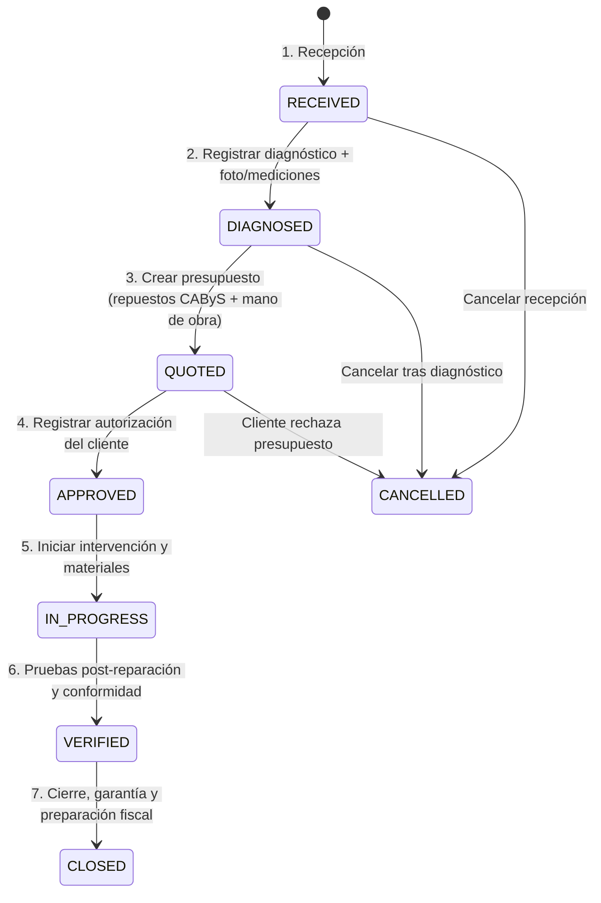

# Flujos de Usuario y Experiencia Operativa — OficiOS

- **Versión:** 1.0.0
- **Fecha:** 2026-11-21
- **Estado:** Propuesto para implementación MVP (Oficio inicial: `hvac-refrigeration-v1`)
- **Referencias:** [Casos de Uso UC-14, UC-15](../02-product/use-cases.md) | [Requisitos QR-OFI-001..007](../03-requirements/requirements-catalog.md) | [Especificaciones de Interfaz](./interface-specifications.md)

---

## 1. Principios de Diseño UX para Pequeños Talleres (OficiOS)

1. **Lenguaje de taller en español de Costa Rica:** Se habla de *Cliente*, *Equipo (Aire Acondicionado / Minisplit)*, *Orden de Servicio*, *Presupuesto*, *Aprobación del cliente*, *Repuestos* y *Factura*. Nunca se muestran UUIDs crudos, claves JSON ni errores SQL.
2. **Alcance estrictamente enfocado en la demo verificable:** Sin módulos de nómina, contabilidad general, CRM de campañas ni inventario multi-bodega en el MVP.
3. **Reglas visibles, nunca sorpresas:** Cuando una transición está bloqueada (ej. cerrar sin aprobación del cliente), la interfaz explica claramente **qué falta** y ofrece el botón directo para completarlo.
4. **Confianza verificable sin fricción:** La procedencia histórica de `Data Exodus` se presenta en un cajón discreto «¿De dónde viene este dato?» para el dueño o contador, sin estorbar la operación diaria del técnico.

---

## 2. Mapa de Estados y Flujo Principal (`hvac-refrigeration-v1`)

### Bloqueo Deliberado de Demostración (`UC-15` / `AT-15`)
- Intentar pasar de `QUOTED` → `IN_PROGRESS` o `QUOTED` → `CLOSED` sin `work_order_approvals`:
  - El servidor rechaza con `HTTP 409` (`ERR_WORK_ORDER_APPROVAL_REQUIRED`).
  - La UI muestra una tarjeta clara: *«No se puede iniciar ni cerrar esta orden todavía: falta registrar la aprobación del presupuesto por parte del cliente (₡85.000).»* + acción directa **«Registrar aprobación del cliente»**.

---

## 3. Recorrido Paso a Paso de las 9 Pantallas/Flujos Esenciales

| # | Flujo | Actor | Campos y acciones esenciales | Validaciones / Reglas |
|---|---|---|---|---|
| **1** | **Recepción de servicio** | Operador / Dueño | Buscar cliente (o crear), seleccionar equipo HVAC existente (o registrar marca/modelo/BTU/refrigerante/ubicación/serie), escribir síntoma reportado. | Crea orden en estado `RECEIVED` con folio legible (ej. `OS-2026-0042`). |
| **2** | **Gestión de clientes y equipos** | Operador / Dueño | Lista filtrable por nombre/cédula/teléfono; ficha de cliente con sus equipos, historial de órdenes y saldo pendiente. | Badge discreto `Migrado` en registros provenientes de `Data Exodus`. |
| **3** | **Consulta de evidencia de procedencia** | Dueño / Auditor | Botón «Ver origen del registro» en ficha de cliente o saldo: muestra línea de tiempo legible (*«Importado de `clientes.xlsx` hoja Clientes fila 42 + `FE-204.xml` — Fusionado por `admin@taller.cr` el 21/11/2026: 'Confirmado mismo cliente'»*). | Lectura sobre `qum_provenance_entries` + `qum_decisions` con hash truncado verificable. |
| **4** | **Diagnóstico técnico** | Técnico | Mediciones específicas de `hvac-refrigeration-v1` (presión PSI baja/alta, temperatura salida °C, amperaje compresor, tipo refrigerante R410A/R32), descripción de falla y subida de fotografía (almacenada en CAS con SHA-256). | Exige al menos descripción de falla y 1 medición o foto para pasar a `DIAGNOSED`. |
| **5** | **Presupuesto y autorización** | Operador / Dueño | Agregar líneas de mano de obra y repuestos con buscador integrado de código **CAByS** (vía `CR API Passport`, con fallback caché offline), montos exactos en `CRC`/`USD` e IVA automático; luego registrar aprobación del cliente (nombre quien aprueba, canal: presencial/WhatsApp manual/correo, fecha/hora y comprobante opcional). | Bloquea avance a `IN_PROGRESS`/`CLOSED` hasta registrar `work_order_approvals` (`QR-OFI-003`). |
| **6** | **Registro de materiales e intervención** | Técnico | Marcar inicio de trabajo (`IN_PROGRESS`), confirmar repuestos/refrigerante realmente consumidos y notas de reparación. | Si el costo real excede el presupuesto aprobado por encima de tolerancia configurada, advierte y pide nueva aprobación. |
| **7** | **Verificación técnica** | Técnico / Cliente | Checklist de pruebas post-reparación (temperatura de descarga alcanzada, prueba de fugas, limpieza, funcionamiento drenaje) y conformidad del cliente. | Transiciona a `VERIFIED` guardando timestamp y técnico responsable. |
| **8** | **Cierre del servicio y preparación fiscal** | Operador / Dueño | Registrar plazo de garantía (ej. 90 días), método de pago (SINPE Móvil, efectivo, tarjeta, transferencia) y botón «Cerrar orden y emitir comprobante». | Transiciona a `CLOSED` y encola **1** `FiscalIntent` en `Fiscal Outbox`; muestra estado separado: *Orden cerrada ✓ | Comprobante fiscal: Pendiente / Aceptado / Requiere revisión*. |
| **9** | **Manejo comprensible de errores** | Todos | Mensajes humanos en español sin stack traces: estado de transición inválida (`409`), permiso insuficiente (`403` para `AUDITOR_READONLY`), modo caché offline en CAByS (`W_PASS_STALE_CACHE`), conflicto de edición concurrente (`409` con botón «Recargar orden»). | Cada mensaje incluye un `correlationId` discreto al pie para soporte técnico. |
