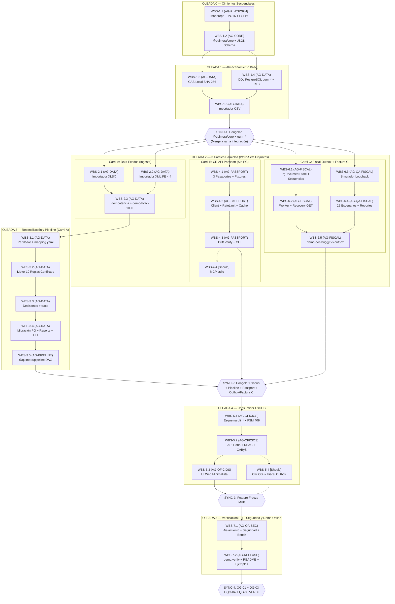

# Work Breakdown Structure (WBS) Orientada a Agentes — QUIMERA

- **Versión:** 1.0.0
- **Fecha:** 2026-11-21
- **Estado:** Lista para despacho directo a agentes de programación (Cloud Agents / CLI Agents / Equipos paralelos)
- **Referencias:** [Plan MVP](./MVP-plan.md) | [Backlog (`US-001`..`US-032`)](./implementation-backlog.md) | [Grafo de Dependencias](./dependency-graph.md) | [Definition of Done](./definition-of-done.md) | [Quality Gates](../08-quality/quality-gates.md)

---

## 1. Principios de Diseño de una WBS Orientada a Agentes

A diferencia de una WBS tradicional centrada en personas y calendario, esta WBS está diseñada para **ejecución por agentes autónomos de código**, donde los fallos más frecuentes provienen de contexto ambiguo, edición simultánea de archivos compartidos, cambios silenciosos de contratos y ausencia de criterios de salida verificables por máquina.

### 5 Reglas de Orquestación Multi-Agente
1. **Particionamiento estricto de escritura (*Write-Set Disjointness*):** Ningún par de paquetes de trabajo (`WBS-X.Y`) ejecutados en la misma oleada puede escribir en los mismos archivos o carpetas.
2. **Propiedad exclusiva de archivos raíz y lockfile:** Los archivos compartidos (`package.json` raíz, `pnpm-workspace.yaml`, `pnpm-lock.yaml`, `turbo.json`, `tsconfig.base.json`, `.eslintrc*`) solo se modifican en la **Oleada 0 (`WBS-1.1`)** o en las **Barreras de Sincronización (`SYNC-*`)**. Durante oleadas paralelas, cada paquete agrega dependencias solo en su `packages/<pkg>/package.json` o usa las ya predeclaradas en `WBS-1.1`.
3. **Migraciones SQL desacopladas por módulo:** `packages/data-exodus/drizzle` (`qum_*`), `packages/fiscal-outbox/drizzle` (`fob_*`) y `apps/oficios/drizzle` (`ofi_*`) mantienen sus propias carpetas y tablas de control de Drizzle, eliminando colisiones de numeración SQL entre agentes paralelos.
4. **Paquete de contexto mínimo obligatorio (*Read Context Pack*):** Cada `WBS-X.Y` indica los documentos exactos bajo `/docs` que el agente debe leer antes de editar código, evitando que cargue todo el repositorio o invente contratos.
5. **Salida verificable por máquina (*Machine-Verifiable Exit Criteria*):** Ningún agente puede marcar un `WBS-X.Y` como completado sin ejecutar y pasar los comandos exactos declarados (`typecheck`, `lint`, `test`, `schemas:export`) con código de salida `0`.

---

## 2. Catálogo de Perfiles de Agente

Cada paquete de trabajo se asigna a un perfil especializado (puede ser ejecutado por agentes distintos en ramas paralelas o por un mismo agente en turnos secuenciales):

| Perfil | Especialidad | Ámbito de escritura principal | Invariantes que protege |
|---|---|---|---|
| `AG-PLATFORM` | Infraestructura monorepo y CI | Raíz (`package.json`, `turbo.json`, `docker-compose.yml`, `.github/workflows/*`) | Reglas ESLint de fronteras (`packages/*` ≠ `apps/*`), Node 22 ESM, `pnpm-lock.yaml` |
| `AG-CORE` | Contratos y tipos núcleo | `packages/core/**` | Cero deps runtime fuera de `zod`; determinismo; `BigInt` dinero; `ERR_*` |
| `AG-DATA` | Ingestión, procedencia y reconciliación | `packages/data-exodus/**`, `fixtures/demo-hvac-1000/**`, `scripts/generate-fixtures.ts` | Cero pérdida silenciosa; sin fusión automática ambigua; sin datos personales reales |
| `AG-PIPELINE` | Motor DAG y checkpoints | `packages/pipeline/**` | Aciclicidad estática; SemVer; `WAITING_FOR_APPROVAL` (`exit 3`); solo retry si `idempotent: true` |
| `AG-PASSPORT` | Integraciones y deriva CR | `packages/cr-api-passport/**` | Rate limit `15/8 req/s`; cero endpoints inventados; `--mode fixture` 100% offline |
| `AG-FISCAL` | Outbox transaccional y demo POS | `packages/fiscal-outbox/**`, `apps/demo-pos/**` | Reutilización de `hacienda-sdk/delivery`; secuencias por `issuerId`; cero `POST` tras timeout |
| `AG-QA-FISCAL` | Simulador loopback y suite `Factura CI` | `packages/factura-ci/**` | Loopback exclusivo (`127.0.0.1`); sin redirecciones; aviso sintético obligatorio |
| `AG-OFICIOS` | Aplicación consumidora HVAC | `apps/oficios/**` | Consumidor puro; FSM con bloqueo `HTTP 409`; RBAC; sin XSS ni jerga SQL en UI |
| `AG-QA-SEC` | Aislamiento, seguridad y E2E | `tests/e2e/**`, `tests/security/**`, `scripts/test-isolation.ts` | Baseline 100% sin IA/Clairic; instalación aislada por paquete; `T-SEC-001..012` |
| `AG-RELEASE` | Demo offline, ejemplos y docs raíz | `README.md`, `scripts/demo-verify.ts`, `examples/**`, `docs/IMPLEMENTATION_STATUS.md` | `QG-06` reproducible en máquina limpia sin Internet |

---

## 3. Mapa de Oleadas de Ejecución y Barreras de Sincronización



---

## 4. Desglose Detallado de Paquetes de Trabajo (`WBS-1` a `WBS-7`)

### WBS-1 — Slice 1: Núcleo, Contratos y Primer Importador (Oleadas 0–1)

#### `WBS-1.1` — Bootstrap del Monorepo, PostgreSQL 16 y Reglas de Frontera
- **Backlog / Requisitos:** `US-001` | `QR-NFR-008`, `QR-NFR-009`, `QR-NFR-010`, `QR-SEC-011`, `QR-OFI-001`
- **Perfil asignado:** `AG-PLATFORM` | **Oleada:** 0 | **Dependencias:** Ninguna | **Complejidad:** `S`
- **Lectura obligatoria (Context Pack):**
  - `docs/04-architecture/ADR/ADR-001-monorepo-modular.md`
  - `docs/04-architecture/ADR/ADR-002-primary-language.md`
  - `docs/04-architecture/software-architecture.md`
  - `docs/08-quality/quality-gates.md`
- **Ámbito de escritura permitido (Write Scope):**
  - `package.json`, `pnpm-workspace.yaml`, `turbo.json`, `tsconfig.base.json`, `eslint.config.mjs`, `vitest.workspace.ts`, `docker-compose.yml`, `.env.example`, `.gitignore`, `.changeset/config.json`, `.github/workflows/ci.yml`
  - Esqueletos mínimos `package.json` + `tsconfig.json` de `packages/{core,data-exodus,cr-api-passport,fiscal-outbox,factura-ci,pipeline}` y `apps/{oficios,demo-pos}` (predeclarando dependencias externas verificadas para minimizar edición posterior del `pnpm-lock.yaml`).
- **Prohibiciones explícitas:**
  - Prohibido agregar `@quimera/adapter-clairic` en `dependencies` de cualquier paquete.
  - Prohibido incluir `make-no-mistakes-toolkit` (BSL 1.1) o librerías con binarios nativos C++.
  - `.gitignore` debe bloquear `*.p12`, `*.pfx`, `*.pem`, `.env`.
- **Entregables:** Workspace `pnpm` funcional en Node 22 ESM + Docker PG 16 + regla ESLint `no-restricted-imports` impidiendo que `packages/*` importe `apps/*` o `@quimera/adapter-clairic`.
- **Criterios de verificación (Exit 0):**
  - `pnpm install --frozen-lockfile || pnpm install`
  - `docker compose up -d postgres && pg_isready -h 127.0.0.1 -p 5432`
  - `pnpm typecheck && pnpm lint`
- **Artefacto de handoff:** `pnpm-lock.yaml` inicial + configuración TS/ESLint congelada.

#### `WBS-1.2` — Contratos Canónicos, Dinero Exacto y Puertos en `@quimera/core`
- **Backlog / Requisitos:** `US-002` | `QR-CORE-001`..`010`, `QR-NFR-005`
- **Perfil asignado:** `AG-CORE` | **Oleada:** 0 | **Dependencias:** `WBS-1.1` | **Complejidad:** `M`
- **Lectura obligatoria:**
  - `docs/06-interfaces/public-contracts.md`
  - `docs/06-interfaces/contracts/core-contracts.schema.json`
  - `docs/04-architecture/ADR/ADR-007-intermodule-contracts.md`
  - `docs/03-requirements/requirements-catalog.md` (§1 `QR-CORE`)
- **Write Scope:** `packages/core/**`
- **Prohibiciones explícitas:**
  - `packages/core/package.json` **solo** puede tener `zod` en `dependencies` (`QR-CORE-002`). Cero imports de `pg`, `drizzle-orm`, `hono`, `fs` (salvo tipos puros) o `hacienda-sdk`.
  - Prohibido usar `number` de punto flotante para sumas monetarias (`QR-CORE-009`).
  - Todos los códigos de error deben seguir el patrón `^ERR_[A-Z0-9_]+$`.
- **Entregables:** Esquemas Zod v4 (`EvidenceArtifact`, `RawRecord`, `NormalizedEntity`, `ProvenanceEntry`, `Conflict`, `ResolutionDecision`, `SchemaVersion`, `QuimeraError`, `OperationResult`), script `schemas:export` (JSON Schema Draft 2020-12), módulo `money` (`BigInt` + ISO 4217), normalizadores deterministas CR (cédula 9–12 dígitos, hash canónico), verificador SemVer y puertos (`ArtifactStorePort`, `StructuredExtractorPort`, `ClockPort`, `LoggerPort`, `PipelineStepPort`).
- **Criterios de verificación (Exit 0):**
  - `pnpm --filter @quimera/core typecheck`
  - `pnpm --filter @quimera/core schemas:export`
  - `pnpm --filter @quimera/core test` (`T-CORE-001`, `T-CORE-002`, `T-CORE-005..010`, ≥200 iteraciones `fast-check`)
- **Artefacto de handoff:** API pública y JSON Schemas congelados de `@quimera/core@0.1.0`.

#### `WBS-1.3` — Almacenamiento CAS Inmutable `SHA-256` (`FsArtifactStore`)
- **Backlog / Requisitos:** `US-003` | `QR-DATA-002`, `QR-SEC-003`, `QR-SEC-006`
- **Perfil asignado:** `AG-DATA` | **Oleada:** 1 (paralelizable con `WBS-1.4`) | **Dependencias:** `WBS-1.2` | **Complejidad:** `S`
- **Lectura obligatoria:** `docs/04-architecture/ADR/ADR-004-immutable-evidence-storage.md`, `docs/07-security/security-requirements.md`
- **Write Scope:** `packages/data-exodus/src/storage/**`, `packages/data-exodus/tests/storage/**`
- **Prohibiciones explícitas:** Prohibido permitir rutas con `..` o fuera del directorio raíz CAS; prohibido devolver bytes sin verificar `SHA-256` en lecturas auditadas.
- **Entregables:** `FsArtifactStore` implementando `ArtifactStorePort` (escritura atómica temp→rename, permisos `0444`, recálculo `SHA-256` lanzando `ERR_ARTIFACT_INTEGRITY_FAILED` ante alteración de 1 byte) + `InMemoryArtifactStore` para pruebas unitarias.
- **Criterios de verificación (Exit 0):** `pnpm --filter @quimera/data-exodus test tests/storage` (`T-SEC-006`, parte path-traversal de `T-SEC-003`).

#### `WBS-1.4` — Esquema PostgreSQL `qum_*`, Migraciones Drizzle y Políticas RLS
- **Backlog / Requisitos:** `US-004` | `QR-NFR-003`, `QR-NFR-011`, `QR-SEC-001`, `QR-SEC-005`
- **Perfil asignado:** `AG-DATA` | **Oleada:** 1 (paralelizable con `WBS-1.3`) | **Dependencias:** `WBS-1.2` | **Complejidad:** `M`
- **Lectura obligatoria:** `docs/05-data/database-design.md`, `docs/05-data/ERD.md`, `docs/05-data/schema-versioning.md`
- **Write Scope:** `packages/data-exodus/drizzle/**`, `packages/data-exodus/src/db/**`, `packages/data-exodus/tests/db/**`
- **Prohibiciones explícitas:**
  - Prohibido `ON DELETE CASCADE` en `qum_artifacts`, `qum_raw_records`, `qum_provenance_entries` y `qum_decisions`.
  - Prohibido omitir `tenant_id NOT NULL` en tablas de negocio o exponer métodos `update`/`delete` en repositorios append-only (`QR-SEC-005`).
- **Entregables:** Esquema Drizzle de las 13 tablas `qum_*`, migración `0001_init_qum.sql`, índices, políticas RLS (`FORCE ROW LEVEL SECURITY`) y helpers de conexión transaccional con `SET LOCAL app.current_tenant_id`.
- **Criterios de verificación (Exit 0):** `pnpm --filter @quimera/data-exodus db:migrate && pnpm --filter @quimera/data-exodus test tests/db` (`QG-04`, `T-SEC-001`, `T-SEC-005`).

#### `WBS-1.5` — Importador CSV (`csv-parse`) con Conteo Sin Pérdida
- **Backlog / Requisitos:** `US-005` | `QR-DATA-001`, `QR-DATA-003`, `QR-SEC-003`
- **Perfil asignado:** `AG-DATA` | **Oleada:** 1 | **Dependencias:** `WBS-1.3`, `WBS-1.4` | **Complejidad:** `M`
- **Lectura obligatoria:** `docs/02-product/use-cases.md` (`UC-01`), `docs/05-data/data-migration-strategy.md`
- **Write Scope:** `packages/data-exodus/src/importers/types.ts`, `packages/data-exodus/src/importers/csv.ts`, `packages/data-exodus/tests/importers/csv.test.ts`
- **Prohibiciones explícitas:** Nunca descartar filas malformadas en silencio; neutralizar prefijos `= + - @` en cualquier exportación CSV.
- **Entregables:** Interfaz `SourceImporterPort` + importador CSV soportando `,`, `;`, `\t`, UTF-8 BOM y Latin-1/Windows-1252 con invariante `total_rows_seen == parsed_ok + parse_errors + skipped_empty`.
- **Criterios de verificación (Exit 0):** `pnpm --filter @quimera/data-exodus test tests/importers/csv.test.ts` (`T-DATA-001`, `AT-01`).

> **Barrera `SYNC-1` (Fin de Slice 1):** Fusionar `WBS-1.1..1.5` a la rama de integración, verificar `pnpm typecheck && pnpm lint && pnpm test`. A partir de este punto se habilitan **3 carriles simultáneos (`WBS-2`, `WBS-4`, `WBS-6`)** con cero solapamiento de archivos.

---

### WBS-2 — Slice 2: XLSX, XML FE 4.4 y Dataset Sintético (Oleada 2 — Carril A)

#### `WBS-2.1` — Importador XLSX (`exceljs`) Seguro Multi-Hoja
- **Backlog / Requisitos:** `US-006` | `QR-DATA-004`, `QR-SEC-003`
- **Perfil asignado:** `AG-DATA` | **Oleada:** 2 (paralelizable con `WBS-2.2`, `WBS-4.*`, `WBS-6.*`) | **Dependencias:** `SYNC-1` | **Complejidad:** `M`
- **Lectura obligatoria:** `docs/02-product/use-cases.md` (`UC-02`), `docs/07-security/threat-model.md` (`TH-01`)
- **Write Scope:** `packages/data-exodus/src/importers/xlsx.ts`, `packages/data-exodus/tests/importers/xlsx.test.ts`
- **Prohibiciones explícitas:** Prohibido ejecutar macros; obligatorio limitar descompresión (default 50 MiB / ratio ≤ 50:1) contra zip-bombs.
- **Entregables:** Parser multi-hoja preservando `xlsx:<hoja>!row:<n>`, fechas seriales a ISO-8601 y advertencia `WARN_XLSX_UNCACHED_FORMULA`.
- **Criterios de verificación (Exit 0):** `pnpm --filter @quimera/data-exodus test tests/importers/xlsx.test.ts` (`T-DATA-002`, `AT-02`).

#### `WBS-2.2` — Importador XML Fiscal FE 4.4/4.3 vía `@dojocoding/hacienda-sdk`
- **Backlog / Requisitos:** `US-007` | `QR-DATA-005`, `QR-SEC-003`
- **Perfil asignado:** `AG-DATA` | **Oleada:** 2 (paralelizable con `WBS-2.1`, `WBS-4.*`, `WBS-6.*`) | **Dependencias:** `SYNC-1` | **Complejidad:** `M`
- **Lectura obligatoria:** `docs/02-product/use-cases.md` (`UC-03`), `docs/04-architecture/ADR/ADR-010-fiscal-testing-and-outbox-boundaries.md`
- **Write Scope:** `packages/data-exodus/src/importers/fe-xml.ts`, `packages/data-exodus/tests/importers/fe-xml.test.ts`
- **Prohibiciones explícitas:** Prohibido reescribir parser XML de Hacienda (usar `parseDocumentXml()` y `verifySignedDocumentXml()` de `@dojocoding/hacienda-sdk`); bloquear `<!DOCTYPE` / entidades externas (`ERR_SEC_XXE_REJECTED`).
- **Entregables:** Importador FE 4.4 + soporte de lectura con advertencia `WARN_XML_LEGACY_V43` para 4.3 + enlace de `MensajeHacienda` por `clave` de 50 dígitos.
- **Criterios de verificación (Exit 0):** `pnpm --filter @quimera/data-exodus test tests/importers/fe-xml.test.ts` (`T-DATA-003`, `AT-03`).

#### `WBS-2.3` — Idempotencia de Ingestión y Generador Sintético `demo-hvac-1000`
- **Backlog / Requisitos:** `US-008` | `QR-DATA-008`, `QR-SEC-009`
- **Perfil asignado:** `AG-DATA` | **Oleada:** 2 | **Dependencias:** `WBS-2.1`, `WBS-2.2` | **Complejidad:** `M`
- **Lectura obligatoria:** `docs/05-data/data-migration-strategy.md`, `docs/08-quality/test-strategy.md` (§3 Fixtures), `docs/05-data/reconciliation-model.md` (§5)
- **Write Scope:** `packages/data-exodus/src/ingest.ts`, `scripts/generate-fixtures.ts`, `fixtures/demo-hvac-1000/**`, `packages/data-exodus/tests/ingest-idempotency.test.ts`
- **Prohibiciones explícitas:** **Cero cédulas, teléfonos ni nombres reales de personas/empresas costarricenses** (`QR-SEC-009`); semilla determinista fija (`--seed 20261121`).
- **Entregables:** Orquestador de ingestión con `idempotency_key` (`inserted = 0` al repetir) + generador reproducible de 7 archivos (1.000 registros con exactamente **40 clientes repetidos, 12 facturas duplicadas, 7 pagos mal atribuidos, 3 clientes con cédulas contradictorias y 1 saldo imposible de reconciliar**).
- **Criterios de verificación (Exit 0):** `pnpm tsx scripts/generate-fixtures.ts --seed 20261121 && pnpm --filter @quimera/data-exodus test tests/ingest-idempotency.test.ts` (`T-DATA-008`, `AT-08`, `T-SEC-009`).

---

### WBS-3 — Slice 3: Reconciliación, Decisiones, Migración y Pipeline (Oleada 3 — Carril A)

#### `WBS-3.1` — Perfilador Estructural CR y Generador de `mapping.yaml`
- **Backlog / Requisitos:** `US-009` | `QR-DATA-006`, `QR-CORE-004`
- **Perfil asignado:** `AG-DATA` | **Oleada:** 3 | **Dependencias:** `WBS-2.3` | **Complejidad:** `M`
- **Lectura obligatoria:** `docs/02-product/use-cases.md` (`UC-04`, `UC-05`), `docs/04-architecture/ADR/ADR-014-extensibility-strategy.md`
- **Write Scope:** `packages/data-exodus/src/profile/**`, `packages/data-exodus/src/mapping/**`, `packages/data-exodus/tests/profile/**`
- **Prohibiciones explícitas:** Prohibido usar `eval`/`new Function` en transformadores; cero llamadas a LLMs.
- **Entregables:** Perfilador determinista (cédulas CR, CAByS, claves 50 dígitos, monedas mixtas, fechas ambiguas) + generador de `mapping.yaml` con puntajes de confianza y etiqueta `NEEDS_REVIEW`.
- **Criterios de verificación (Exit 0):** `pnpm --filter @quimera/data-exodus test tests/profile` (`T-DATA-004`, `T-DATA-005`, `AT-04`, `AT-05`).

#### `WBS-3.2` — Motor de Reconciliación (10 Reglas) y Conflictos Conservadores
- **Backlog / Requisitos:** `US-010` | `QR-DATA-007`, `QR-DATA-009`
- **Perfil asignado:** `AG-DATA` | **Oleada:** 3 | **Dependencias:** `WBS-3.1` | **Complejidad:** `L`
- **Lectura obligatoria:** `docs/05-data/reconciliation-model.md`, `docs/04-architecture/ADR/ADR-006-conflict-reconciliation-model.md`
- **Write Scope:** `packages/data-exodus/src/reconcile/**`, `packages/data-exodus/tests/reconcile/**`
- **Prohibiciones explícitas:** Prohibido auto-fusionar duplicados probables (`PROBABLE_DUPLICATE`), cédulas contradictorias o discrepancias monetarias; prohibido crear `EntityRelation` desde inferencias no verificadas.
- **Entregables:** Implementación de las 10 estrategias de conflicto (`EXACT_DUPLICATE` auto-resuelto con trazabilidad; las 9 restantes abren `Conflict` con evidencia) validada sobre `demo-hvac-1000`.
- **Criterios de verificación (Exit 0):** `pnpm --filter @quimera/data-exodus test tests/reconcile` (`T-DATA-006`, `AT-06` — detección 100% de 40+12+7+3+1).

#### `WBS-3.3` — Decisiones Humanas Inmutables (`ResolutionDecision`) y Consulta `trace`
- **Backlog / Requisitos:** `US-011` | `QR-DATA-010`, `QR-DATA-011`, `QR-NFR-002`
- **Perfil asignado:** `AG-DATA` | **Oleada:** 3 | **Dependencias:** `WBS-3.2` | **Complejidad:** `M`
- **Lectura obligatoria:** `docs/05-data/data-provenance.md`, `docs/02-product/use-cases.md` (`UC-07`)
- **Write Scope:** `packages/data-exodus/src/decisions/**`, `packages/data-exodus/src/provenance/**`, `packages/data-exodus/tests/decisions/**`
- **Prohibiciones explícitas:** Prohibido sobrescribir o borrar una `ResolutionDecision` existente (solo enmienda con `supersedes_decision_id`).
- **Entregables:** Servicio de resolución individual y por archivo `decisions.yaml`, más motor `trace(entityId, fieldPath?)` devolviendo árbol completo de archivos (`sha256`), locators, reglas y decisiones.
- **Criterios de verificación (Exit 0):** `pnpm --filter @quimera/data-exodus test tests/decisions` (`T-DATA-007`, `T-DATA-011`, `AT-07`).

#### `WBS-3.4` — Carga Destino PostgreSQL (`--dry-run`, Bloqueo, Reporte) y CLI Exodus
- **Backlog / Requisitos:** `US-012` | `QR-DATA-013`, `QR-NFR-007`
- **Perfil asignado:** `AG-DATA` | **Oleada:** 3 | **Dependencias:** `WBS-3.3` | **Complejidad:** `M`
- **Lectura obligatoria:** `docs/05-data/data-migration-strategy.md`, `docs/06-interfaces/CLI-design.md` (§3.1)
- **Write Scope:** `packages/data-exodus/src/migrate/**`, `packages/data-exodus/src/cli.ts`, `packages/data-exodus/src/index.ts`, `packages/data-exodus/tests/migrate/**`
- **Prohibiciones explícitas:** Prohibido importar nada de `apps/oficios` (`ADR-011`); `oficios-v1` se registra como definición declarativa de `TargetSchema` intercambiable (incluir test con un `generic-crm-v1` mínimo). Logs únicamente a `stderr`; `--json` puro en `stdout`.
- **Entregables:** Cargador transaccional idempotente, `--dry-run` con rollback, bloqueo `ERR_MIGRATION_BLOCKED_BY_CONFLICTS`, `ReconciliationReport` en CAS y binario CLI `quimera-exodus`.
- **Criterios de verificación (Exit 0):** `pnpm --filter @quimera/data-exodus test` (`T-DATA-013`, `AT-10`).

#### `WBS-3.5` — Motor DAG `@quimera/pipeline` con Checkpoints y Compuerta Humana
- **Backlog / Requisitos:** `US-013` | `QR-PIPE-001`..`007`, `QR-DATA-012`, `QR-NFR-004`
- **Perfil asignado:** `AG-PIPELINE` | **Oleada:** 3 | **Dependencias:** `WBS-3.4` | **Complejidad:** `L`
- **Lectura obligatoria:** `docs/04-architecture/pipeline-architecture.md`, `docs/04-architecture/ADR/ADR-008-pipeline-design.md`, `docs/06-interfaces/contracts/pipeline-exodus-oficios.yaml`
- **Write Scope:** `packages/pipeline/**`
- **Prohibiciones explícitas:** Prohibido reintentar automáticamente pasos con `idempotent: false`; prohibido prometer *exactly-once* en logs o docs; prohibido continuar si el `SHA-256` de entrada cambió antes de `resume`.
- **Entregables:** Validador estático de DAG (aciclicidad + compatibilidad SemVer), ejecutor con `qum_execution_runs`/`qum_checkpoints`, paso `pipeline.human_review` (`WAITING_FOR_APPROVAL`, exit code `3`), `resume`, compensaciones declaradas y CLI `quimera-pipeline`.
- **Criterios de verificación (Exit 0):** `pnpm --filter @quimera/pipeline test` (`T-PIPE-001..007`, `T-DATA-012`, `AT-09`, `AT-12`).

---

### WBS-4 — Slice 4: `CR API Passport` (Oleada 2 — Carril B Paralelo, sin PostgreSQL)

#### `WBS-4.1` — `ApiPassportSchema`, 3 Pasaportes Verificados CR y Fixtures Offline
- **Backlog / Requisitos:** `US-014` | `QR-PASS-001`, `QR-PASS-002`, `QR-PASS-007`, `QR-PASS-008`
- **Perfil asignado:** `AG-PASSPORT` | **Oleada:** 2 | **Dependencias:** `SYNC-1` | **Complejidad:** `M`
- **Lectura obligatoria:** `docs/06-interfaces/api-passport-design.md`, `docs/06-interfaces/contracts/passport-hacienda-cabys.yaml`, `docs/RESEARCH_LOG.md`
- **Write Scope:** `packages/cr-api-passport/src/schema/**`, `packages/cr-api-passport/passports/**`, `packages/cr-api-passport/fixtures/**`, `packages/cr-api-passport/tests/schema/**`
- **Prohibiciones explícitas:** **Prohibido usar el SOAP descontinuado del BCCR**; **prohibido inventar endpoints privados para Correos de Costa Rica** (solo ficha `accessTier: "private_contract_required"`).
- **Entregables:** Esquema Zod + JSON Schema de `ApiPassport`, manifiestos YAML y fixtures sintéticos/grabados para `cr.hacienda.taxpayer`, `cr.hacienda.cabys`, `cr.hacienda.fx` + `cr.bccr.sdde`, más fichas informativas de SNIT OGC y Correos CR.
- **Criterios de verificación (Exit 0):** `pnpm --filter @quimera/cr-api-passport test tests/schema` (`T-PASS-001`, `T-PASS-002`, `T-PASS-007`).

#### `WBS-4.2` — Cliente HTTP con Rate Limiter Conservador, Caché TTL y Guardrail Auth
- **Backlog / Requisitos:** `US-015` | `QR-PASS-004`, `QR-PASS-005`, `QR-PASS-006`, `QR-SEC-002`
- **Perfil asignado:** `AG-PASSPORT` | **Oleada:** 2 | **Dependencias:** `WBS-4.1` | **Complejidad:** `M`
- **Lectura obligatoria:** `docs/06-interfaces/api-passport-design.md` (§3), `docs/07-security/reliability-and-recovery.md` (§3.3)
- **Write Scope:** `packages/cr-api-passport/src/client/**`, `packages/cr-api-passport/tests/client/**`
- **Prohibiciones explícitas:** Nunca superar `15 req/s` ráfaga / `8 req/s` sostenido hacia `api.hacienda.go.cr`; nunca hacer solicitud HTTP si falta `BCCR_SDDE_TOKEN` (`ERR_AUTH_MISSING_CREDENTIALS`); nunca loguear `Authorization` ni PII de `/fe/ae`.
- **Entregables:** Cliente tipado con bucket por host, circuit-breaker `429 Retry-After`, caché TTL con `{ fetchedAt, fromCache, stale, passportVersion }` y modo `--mode fixture` 100% offline.
- **Criterios de verificación (Exit 0):** `pnpm --filter @quimera/cr-api-passport test tests/client` (`T-PASS-004`, `T-PASS-005`, `T-PASS-006`).

#### `WBS-4.3` — Detector de Deriva (`verify`), Generador TS y CLI `quimera-passport`
- **Backlog / Requisitos:** `US-016` | `QR-PASS-003`, `QR-NFR-007`
- **Perfil asignado:** `AG-PASSPORT` | **Oleada:** 2 | **Dependencias:** `WBS-4.2` | **Complejidad:** `M`
- **Lectura obligatoria:** `docs/06-interfaces/CLI-design.md` (§3.2), `docs/06-interfaces/versioning-policy.md`
- **Write Scope:** `packages/cr-api-passport/src/verify/**`, `packages/cr-api-passport/src/generate/**`, `packages/cr-api-passport/src/cli.ts`, `packages/cr-api-passport/src/index.ts`, `packages/cr-api-passport/tests/verify/**`
- **Prohibiciones explícitas:** Ningún test de PR puede requerir acceso real a Internet; exit code `5` ante `ERR_PASSPORT_CONTRACT_DRIFT` y `4` ante `ERR_AUTH_MISSING_CREDENTIALS`.
- **Entregables:** Motor `DriftReport` (detecta campos faltantes, tipos cambiados y status inesperados), generador de adaptador TS + test Vitest, `getCapabilities()` y CLI completa (`list`, `inspect`, `query`, `verify`, `generate`).
- **Criterios de verificación (Exit 0):** `pnpm --filter @quimera/cr-api-passport test` (`T-PASS-003`, `AT-11`).

#### `WBS-4.4` `[Should]` — Servidor MCP `stdio` Read-Only (`@quimera/cr-api-passport`)
- **Backlog / Requisitos:** `US-017` | `QR-NFR-006`, `QR-SEC-004`
- **Perfil asignado:** `AG-PASSPORT` | **Oleada:** 2 (recortable si falta tiempo en hackathon) | **Dependencias:** `WBS-4.3` | **Complejidad:** `S`
- **Lectura obligatoria:** `docs/06-interfaces/MCP-design.md`, `docs/04-architecture/ADR/ADR-009-mcp-selective-adoption.md`
- **Write Scope:** `packages/cr-api-passport/src/mcp/**`, `packages/cr-api-passport/tests/mcp/**`
- **Prohibiciones explícitas:** Solo herramientas de lectura/verificación (`passport_list`, `passport_inspect`, `passport_query`, `passport_verify`); marcar siempre `"untrustedExternalData": true`; no adoptar Cloudflare Code Mode.
- **Criterios de verificación (Exit 0):** `pnpm --filter @quimera/cr-api-passport test tests/mcp` (`T-PASS-007`).

---

### WBS-6 — Slice 6: `Fiscal Outbox`, `Factura CI` y `demo-pos` (Oleada 2 — Carril C Paralelo)

#### `WBS-6.1` — `PgDocumentStore`, Tablas `fob_*` y Reserva Atómica de Consecutivos
- **Backlog / Requisitos:** `US-021` | `QR-OUT-001`, `QR-OUT-002`, `QR-OUT-003`
- **Perfil asignado:** `AG-FISCAL` | **Oleada:** 2 (paralelizable con `WBS-6.3`, `WBS-2.*`, `WBS-4.*`) | **Dependencias:** `SYNC-1` | **Complejidad:** `L`
- **Lectura obligatoria:** `docs/04-architecture/ADR/ADR-010-fiscal-testing-and-outbox-boundaries.md`, `docs/05-data/database-design.md` (§3)
- **Write Scope:** `packages/fiscal-outbox/drizzle/**`, `packages/fiscal-outbox/src/store/**`, `packages/fiscal-outbox/tests/store/**`
- **Prohibiciones explícitas:** Prohibido reimplementar `VALID_TRANSITIONS` o `classifySendResult` de `@dojocoding/hacienda-sdk/delivery`; prohibido usar `sequences.json` en disco; consecutivos siempre particionados por `(tenant_id, issuer_id, environment, branch, terminal, doc_type)`.
- **Entregables:** Migración `0001_init_fob.sql`, `PgDocumentStore` implementando `DocumentStore` del SDK, `enqueueIntent()` idempotente (`UNIQUE (tenant_id, environment, operation_id, purpose)`) y `allocateConsecutive()` transaccional.
- **Criterios de verificación (Exit 0):** `pnpm --filter @quimera/fiscal-outbox db:migrate && pnpm --filter @quimera/fiscal-outbox test tests/store` (`T-OUT-001`, `T-OUT-002`, `T-OUT-003` con 50 reservas concurrentes en 2 procesos).

#### `WBS-6.2` — Worker `SKIP LOCKED`, Lease y Reconciliación Segura `GET` Post-Timeout
- **Backlog / Requisitos:** `US-022` | `QR-OUT-004`, `QR-OUT-005`, `QR-OUT-006`, `QR-OUT-007`, `QR-SEC-007`
- **Perfil asignado:** `AG-FISCAL` | **Oleada:** 2 | **Dependencias:** `WBS-6.1` | **Complejidad:** `L`
- **Lectura obligatoria:** `docs/07-security/reliability-and-recovery.md` (§3.2), `docs/06-interfaces/CLI-design.md` (§3.5)
- **Write Scope:** `packages/fiscal-outbox/src/worker/**`, `packages/fiscal-outbox/src/cli.ts`, `packages/fiscal-outbox/src/index.ts`, `packages/fiscal-outbox/tests/worker/**`
- **Prohibiciones explícitas:** **JAMÁS reenviar `POST` automáticamente tras timeout o 5xx post-envío** (solo transición a `PENDIENTE`/`INCIERTO` + consulta `GET` por la misma `clave`); rechazar certificados `.p12` vencidos antes de firmar; cero imports de Cloudflare SDK en el núcleo.
- **Entregables:** Worker con `SELECT ... FOR UPDATE SKIP LOCKED` + `lease_expires_at`, interfaz `OutboxSchedulerPort`, persistencia inmutable de XML firmado/acuse en CAS y CLI `quimera-outbox` (`status`, `reconcile`).
- **Criterios de verificación (Exit 0):** `pnpm --filter @quimera/fiscal-outbox test` (`T-OUT-004..007`, `T-SEC-007`).

#### `WBS-6.3` — Simulador Loopback Determinista de `@quimera/factura-ci` (Sin PG)
- **Backlog / Requisitos:** `US-023` | `QR-FCI-001`, `QR-SEC-012`
- **Perfil asignado:** `AG-QA-FISCAL` | **Oleada:** 2 (paralelizable con `WBS-6.1` y `WBS-6.2`) | **Dependencias:** `SYNC-1` | **Complejidad:** `M`
- **Lectura obligatoria:** `docs/08-quality/failure-scenarios.md`, `docs/07-security/security-requirements.md` (`QR-SEC-012`)
- **Write Scope:** `packages/factura-ci/src/simulator/**`, `fixtures/fiscal-certs-mock/**`, `packages/factura-ci/tests/simulator/**`
- **Prohibiciones explícitas:** **Bind exclusivo a `127.0.0.1` / `::1`** (lanzar `ERR_SEC_LOOPBACK_ONLY` si se intenta otra interfaz/host); desactivar redirecciones HTTP; cero certificados reales (solo certificado sintético autofirmado + 1 expirado para pruebas).
- **Entregables:** Simulador HTTP determinista inyectando los 7 modos (`201/aceptado`, `rechazado`, `procesando`, `409`, `429`, `503`, corte TCP tras recibir `POST`) con bitácora observable de todas las claves y consecutivos recibidos.
- **Criterios de verificación (Exit 0):** `pnpm --filter @quimera/factura-ci test tests/simulator` (`T-FCI-001`, `T-SEC-012`).

#### `WBS-6.4` — Suite de 25 Escenarios Conductuales (`FC-001..024` + `FC-031`) y Reportes
- **Backlog / Requisitos:** `US-024` | `QR-FCI-002`..`008`, `QR-NFR-007`
- **Perfil asignado:** `AG-QA-FISCAL` | **Oleada:** 2 | **Dependencias:** `WBS-6.3` | **Complejidad:** `L`
- **Lectura obligatoria:** `docs/08-quality/failure-scenarios.md` (§2 completo), `docs/06-interfaces/CLI-design.md` (§3.3)
- **Write Scope:** `packages/factura-ci/src/scenarios/**`, `packages/factura-ci/src/reporters/**`, `packages/factura-ci/src/cli.ts`, `packages/factura-ci/src/index.ts`, `packages/factura-ci/tests/scenarios/**`
- **Prohibiciones explícitas:** Toda salida terminal/JSON/JUnit **debe** incluir el campo/aviso `disclaimer` aclarando que son pruebas sintéticas y no certificación oficial de Hacienda; delegar validación XSD a `@dojocoding/hacienda-sdk`.
- **Entregables:** Runner de 25 escenarios (familias A–F incluyendo `FC-017` y `FC-031`), reporteros `pretty`/`json`/`junit`, exit codes `0/1/2` y binario CLI `quimera-factura-ci`.
- **Criterios de verificación (Exit 0):** `pnpm --filter @quimera/factura-ci test` (`T-FCI-002..008`).

#### `WBS-6.5` — SUT Comparativa `apps/demo-pos` (`demo-pos-buggy` vs `demo-pos-outbox`)
- **Backlog / Requisitos:** `US-025` | `QR-FCI-002`, `QR-FCI-003`
- **Perfil asignado:** `AG-FISCAL` | **Oleada:** 2 | **Dependencias:** `WBS-6.2`, `WBS-6.4` | **Complejidad:** `M`
- **Lectura obligatoria:** `docs/08-quality/acceptance-tests.md` (`AT-16`), `docs/11-implementation/MVP-plan.md` (§4 Acto 4)
- **Write Scope:** `apps/demo-pos/**`
- **Prohibiciones explícitas:** Prohibido ocultar el bug de `demo-pos-buggy` con sleeps artificiales; el modo `buggy` debe fallar genuinamente en `FC-017` y `FC-031` y el modo `outbox` debe aprobar 25/25 usando `@quimera/fiscal-outbox`.
- **Entregables:** Servidor POS mínimo con flag `--mode buggy|outbox` y prueba automatizada comparativa.
- **Criterios de verificación (Exit 0):** `pnpm --filter @quimera/demo-pos test` (`AT-16`: `buggy` devuelve `exit 1` con `FC-017`+`FC-031`, `outbox` devuelve `exit 0` con `25/25`).

> **Barrera `SYNC-2` (Fin de Oleadas 2–3):** Integrar Carriles A (`WBS-2` + `WBS-3`), B (`WBS-4`) y C (`WBS-6`). Verificar `demo-hvac-1000` migrado + `CR API Passport` + `Factura CI` contra `demo-pos`.

---

### WBS-5 — Slice 5: `OficiOS` como Consumidor Puro (Oleada 4)

#### `WBS-5.1` — Esquema `ofi_*`, Contrato `hvac-refrigeration-v1` y FSM Estricta
- **Backlog / Requisitos:** `US-018` | `QR-OFI-001`, `QR-OFI-002`, `QR-OFI-003`
- **Perfil asignado:** `AG-OFICIOS` | **Oleada:** 4 | **Dependencias:** `SYNC-2` | **Complejidad:** `M`
- **Lectura obligatoria:** `docs/04-architecture/ADR/ADR-011-oficios-separation.md`, `docs/05-data/ERD.md` (§2), `docs/10-experience/oficios-user-flows.md`
- **Write Scope:** `apps/oficios/drizzle/**`, `apps/oficios/src/domain/**`, `apps/oficios/tests/domain/**`
- **Prohibiciones explícitas:** Ningún archivo fuera de `apps/oficios/**` puede tocarse; estado de aprobación canónico es `APPROVED` (no `AUTHORIZED`); concurrencia optimista obligatoria vía columna `version`.
- **Entregables:** Migración `0001_init_ofi.sql` (`ofi_customers`, `ofi_equipment`, `ofi_work_orders`, `ofi_work_order_events`), contrato `hvac-refrigeration-v1` y máquina de estados rechazando saltos sin aprobación con `ERR_WORK_ORDER_APPROVAL_REQUIRED`.
- **Criterios de verificación (Exit 0):** `pnpm --filter @quimera/oficios db:migrate && pnpm --filter @quimera/oficios test tests/domain` (`T-OFI-001`, `T-OFI-002`, `AT-15`).

#### `WBS-5.2` — API REST Hono de OficiOS con RBAC, Procedencia y CAByS
- **Backlog / Requisitos:** `US-019` | `QR-OFI-004`, `QR-OFI-005`, `QR-SEC-008`
- **Perfil asignado:** `AG-OFICIOS` | **Oleada:** 4 | **Dependencias:** `WBS-5.1` | **Complejidad:** `M`
- **Lectura obligatoria:** `docs/10-experience/interface-specifications.md`, `docs/07-security/privacy-and-data-handling.md`
- **Write Scope:** `apps/oficios/src/api/**`, `apps/oficios/tests/api/**`
- **Prohibiciones explícitas:** Nunca aceptar `tenantId` libre desde el body del request (siempre derivado del token autenticado); `AUDITOR_READONLY` debe recibir `403 Forbidden` en cualquier mutación.
- **Entregables:** Endpoints `/api/v1/*` (`health`, `customers`, `customers/:id/provenance`, `equipment`, `catalog/cabys`, `work-orders`, `evidence`, `approvals`, `transition`, `close`).
- **Criterios de verificación (Exit 0):** `pnpm --filter @quimera/oficios test tests/api` (`T-OFI-003`, `T-OFI-004`, `T-SEC-008`).

#### `WBS-5.3` — UI Web Minimalista de OficiOS (Español CR)
- **Backlog / Requisitos:** `US-020` | `QR-OFI-002`..`005`
- **Perfil asignado:** `AG-OFICIOS` | **Oleada:** 4 (paralelizable con `WBS-5.4`) | **Dependencias:** `WBS-5.2` (y decisión `OD-01`) | **Complejidad:** `M`
- **Lectura obligatoria:** `docs/10-experience/oficios-user-flows.md`, `docs/10-experience/interface-specifications.md` (§5)
- **Write Scope:** `apps/oficios/web/**`, `apps/oficios/tests/web/**`
- **Prohibiciones explícitas:** Prohibido renderizar HTML sin escapar desde datos migrados (prevención XSS); prohibido agregar pantallas fuera de los 9 flujos esenciales de demo.
- **Entregables:** Vistas responsive minimalistas: Clientes + cajón «Ver origen del registro», Orden HVAC con foto/mediciones/CAByS, tarjeta explícita de bloqueo `HTTP 409` sin aprobación y cierre.
- **Criterios de verificación (Exit 0):** `pnpm --filter @quimera/oficios build && pnpm --filter @quimera/oficios test` (`AT-14`, `AT-15`).

#### `WBS-5.4` `[Should]` — Integración `OficiOS -> Fiscal Outbox` al Cierre de Orden
- **Backlog / Requisitos:** `US-026` | `QR-OFI-006`, `QR-OFI-007`
- **Perfil asignado:** `AG-OFICIOS` | **Oleada:** 4 (paralelizable con `WBS-5.3`) | **Dependencias:** `WBS-5.2` | **Complejidad:** `S`
- **Lectura obligatoria:** `docs/02-product/use-cases.md` (`UC-14`), `docs/07-security/reliability-and-recovery.md` (§3.2)
- **Write Scope:** `apps/oficios/src/fiscal/**`, `apps/oficios/tests/fiscal/**`
- **Prohibiciones explícitas:** El cierre operativo (`CLOSED`) nunca puede bloquearse si el simulador/Hacienda no responde; no depender de WhatsApp Adapter.
- **Entregables:** Encolado idempotente de 1 `FiscalIntent` (`operationId = workOrder.id`) al cerrar orden + exposición separada del estado fiscal en `GET /api/v1/work-orders/:id`.
- **Criterios de verificación (Exit 0):** `pnpm --filter @quimera/oficios test tests/fiscal` (`T-OFI-005`, `T-OFI-006`).

> **Barrera `SYNC-3` (Feature Freeze MVP):** Integración de `apps/oficios` completa. Se congela el ingreso de nuevas funcionalidades; solo se permiten correcciones de defectos y pruebas en Oleada 5.

---

### WBS-7 — Slice 7: Verificación Transversal, Seguridad y Demo Offline (Oleada 5)

#### `WBS-7.1` — Suite de Aislamiento por Paquete, Baseline Sin IA, Seguridad y Benchmarks
- **Backlog / Requisitos:** `US-027` | `QR-CORE-003`, `QR-CORE-004`, `QR-CLAI-001`, `QR-NFR-001`, `QR-NFR-002`, `QR-SEC-001`..`012`
- **Perfil asignado:** `AG-QA-SEC` | **Oleada:** 5 | **Dependencias:** `SYNC-3` | **Complejidad:** `M`
- **Lectura obligatoria:** `docs/08-quality/test-strategy.md`, `docs/08-quality/test-matrix.md`, `docs/07-security/security-requirements.md`
- **Write Scope:** `scripts/test-isolation.ts`, `fixtures/security-malicious/**`, `tests/e2e/**`, `tests/security/**`, `scripts/bench.ts`
- **Prohibiciones explícitas:** Ningún test puede usar red externa ni `@quimera/adapter-clairic`; los fixtures maliciosos deben ser 100% sintéticos y seguros en disco.
- **Entregables:**
  - `pnpm test:isolation`: empaqueta (`pnpm pack`) e instala cada `@quimera/*` en directorio limpio sin `OficiOS` ni `Clairic` (`T-CORE-003`).
  - `tests/security/*`: cubre `T-SEC-001`..`012` (RLS, redacción secretos, XXE/zip-bomb/CSV-injection, append-only, integridad CAS, cert expirado, RBAC, PII fixtures, loopback-only).
  - `tests/e2e/baseline-offline.test.ts` (`T-CORE-004`, `T-CLAI-001`, `AT-13`, `AT-17`) y `pnpm bench` (`QR-NFR-001` ≤ 5s, `QR-NFR-002` ≤ 150 ms).
- **Criterios de verificación (Exit 0):** `pnpm test:isolation && pnpm test:security && pnpm test:e2e && pnpm audit --audit-level=high`.

#### `WBS-7.2` — Script `pnpm demo:verify` (4 Actos Offline), `README.md` y 4 Ejemplos
- **Backlog / Requisitos:** `US-028` | `QR-NFR-008`, `QG-06`
- **Perfil asignado:** `AG-RELEASE` | **Oleada:** 5 | **Dependencias:** `WBS-7.1` | **Complejidad:** `S`
- **Lectura obligatoria:** `docs/11-implementation/MVP-plan.md` (§4), `docs/10-experience/developer-experience.md` (§2 y §6), `docs/08-quality/quality-gates.md` (`QG-06`)
- **Write Scope:** `README.md`, `scripts/demo-verify.ts`, `examples/01-passport-cabys/**`, `examples/02-exodus-demo-1000/**`, `examples/03-factura-ci-pos/**`, `examples/04-pipeline-oficios/**`, `docs/IMPLEMENTATION_STATUS.md`
- **Prohibiciones explícitas:** Prohibido hardcodear rutas absolutas locales o asumir acceso a Internet en `demo-verify.ts`.
- **Entregables:** Comando único `pnpm demo:verify` ejecutando los 4 actos completos offline + guía de arranque en ≤5 min en `README.md` + 4 ejemplos ejecutables + actualización del tablero en `docs/IMPLEMENTATION_STATUS.md`.
- **Criterios de verificación (Exit 0):** `QUIMERA_AI_ENABLED=false pnpm demo:verify` (`QG-06` completo).

> **Compuerta Final `SYNC-4` (MVP Listo):** `QG-01`, `QG-03`, `QG-04` y `QG-06` en verde en máquina limpia.

---

### WBS-8 — Paquetes de Trabajo Post-MVP (Fuera del Camino Crítico del Hackathon)

| WBS ID | Backlog | Perfil | Write Scope exclusivo | Prerrequisito | Requisitos |
|---|---|---|---|---|---|
| `WBS-8.1` | `US-029` | `AG-DATA` | `packages/adapter-clairic/**` (nunca importado desde otros paquetes) | `SYNC-4` + `OD-08` | `QR-CLAI-001`..`004`, `QR-SEC-004` (`AT-18`) |
| `WBS-8.2` | `US-030` | `AG-DATA` | `packages/data-exodus/src/importers/{sqlite,json}.ts` | `SYNC-4` | `QR-DATA-014` (`T-DATA-014`) |
| `WBS-8.3` | `US-031` | `AG-OFICIOS` | `apps/oficios/src/notifications/whatsapp-adapter.ts` | `SYNC-4` + Piloto | `QR-OFI-007` |
| `WBS-8.4` | `US-032` | `AG-PASSPORT` | `packages/cr-api-passport/passports/cr.snit.geodata.yaml`, `marketplace/**` | `SYNC-4` + `OD-04` | `QR-PASS-008` |

---

## 5. Matriz de Propiedad de Archivos (Prevención de Conflictos en Paralelo)

| Ruta del repositorio | Único propietario en Oleada 0–1 | Único propietario en Oleada 2–3 | Único propietario en Oleada 4–5 |
|---|---|---|---|
| Raíz (`package.json`, `pnpm-lock.yaml`, `turbo.json`, `docker-compose.yml`) | `AG-PLATFORM` (`WBS-1.1`) | **Solo lectura** (cambios únicamente en `SYNC-*`) | `AG-RELEASE` solo `README.md` |
| `packages/core/**` | `AG-CORE` (`WBS-1.2`) | **Congelado (solo lectura)** | **Congelado** |
| `packages/data-exodus/**`, `fixtures/demo-hvac-1000/**`, `scripts/generate-fixtures.ts` | `AG-DATA` (`WBS-1.3..1.5`) | `AG-DATA` (`WBS-2.*`, `WBS-3.1..3.4`) | **Solo lectura** |
| `packages/pipeline/**` | Esqueleto `WBS-1.1` | `AG-PIPELINE` (`WBS-3.5`) | **Solo lectura** |
| `packages/cr-api-passport/**` | Esqueleto `WBS-1.1` | `AG-PASSPORT` (`WBS-4.1..4.4`) | **Solo lectura** |
| `packages/fiscal-outbox/**`, `apps/demo-pos/**` | Esqueleto `WBS-1.1` | `AG-FISCAL` (`WBS-6.1`, `6.2`, `6.5`) | **Solo lectura** |
| `packages/factura-ci/**`, `fixtures/fiscal-certs-mock/**` | Esqueleto `WBS-1.1` | `AG-QA-FISCAL` (`WBS-6.3`, `6.4`) | **Solo lectura** |
| `apps/oficios/**` | Esqueleto `WBS-1.1` | No tocado | `AG-OFICIOS` (`WBS-5.1..5.4`) |
| `tests/e2e/**`, `tests/security/**`, `scripts/test-isolation.ts`, `fixtures/security-malicious/**` | No tocado | No tocado | `AG-QA-SEC` (`WBS-7.1`) |
| `scripts/demo-verify.ts`, `examples/**`, `docs/IMPLEMENTATION_STATUS.md` | No tocado | No tocado | `AG-RELEASE` (`WBS-7.2`) |

---

## 6. Protocolo Operativo y Plantilla de Prompt para Despachar un Agente

### 6.1. Reglas de Rama y PR por Paquete de Trabajo
1. Cada agente trabaja en una rama dedicada desde la última barrera `SYNC-k`: `feat/wbs-<X>-<Y>-<slug>` (o el prefijo configurado por la plataforma).
2. Antes de codificar, el agente **debe leer todos los archivos de su Context Pack**.
3. Al terminar, el agente ejecuta los comandos de verificación declarados en su `WBS-X.Y`, actualiza `docs/IMPLEMENTATION_STATUS.md` solo en `SYNC-*` o `WBS-7.2` (para evitar conflictos de merge en ramas paralelas) y abre su PR reportando la salida real de los tests.

### 6.2. Cuándo Debe Detenerse y Escalar un Agente (Regla Stop-and-Escalate)
Un agente **debe detenerse y reportar bloqueo explícito** (sin inventar workarounds silenciosos) cuando:
1. Necesita modificar un contrato congelado de `@quimera/core` fuera de `WBS-1.2` (requiere cambio coordinado en barrera `SYNC-*` + actualización de ADR/contrato).
2. Encuentra una decisión abierta bloqueante sin resolver (ej. `OD-01` al arrancar `WBS-5.3`).
3. Detecta una incompatibilidad real en `@dojocoding/hacienda-sdk@0.13.0` distinta de lo documentado en `docs/RESEARCH_LOG.md`.
4. Un criterio de seguridad o invariante (`QR-SEC-*`, `T-OFI-001`, `T-CORE-004`) falla y no puede corregirse dentro de su Write Scope.

### 6.3. Plantilla Estándar de Instrucción para Agente (`Agent Task Dispatch Prompt`)

```markdown
# Tarea de Implementación: WBS-<X.Y> (<Título>)

## Perfil y Alcance
- **WBS ID:** `WBS-<X.Y>` (mapea a `US-<NNN>`)
- **Requisitos obligatorios:** `<QR-...>`
- **Pruebas obligatorias:** `<T-...>`, `<AT-...>`

## Context Pack (LEER ANTES DE EDITAR)
Lee exactamente estos documentos para obtener contratos, esquemas y decisiones vigentes:
- `<ruta/doc-1.md>`
- `<ruta/doc-2.md>`

## Write Scope (ÚNICAS RUTAS QUE PUEDES CREAR O MODIFICAR)
- `<glob permitido 1>`
- `<glob permitido 2>`
No modifiques archivos fuera de estas rutas. Si detectas que falta un cambio en `@quimera/core` o en `package.json` raíz, detente y reporta el bloqueo.

## Invariantes y Prohibiciones
- Baseline 100% libre de IA y sin acceso a red externa en tests.
- Códigos de error con prefijo `ERR_*` conforme a `QuimeraError`.
- Cero cédulas ni datos reales de personas/empresas en fixtures o tests.
- `<prohibiciones específicas de WBS-X.Y>`

## Verificación Obligatoria (DEBE SALIR CON EXIT CODE 0)
1. `<comando typecheck>`
2. `<comando lint>`
3. `<comando test específico>`

## Reporte Final Esperado
Entrega: lista de archivos tocados, pruebas ejecutadas con resultado real, cualquier hallazgo o desviación detectada y confirmación de que respetaste el Write Scope.
```
