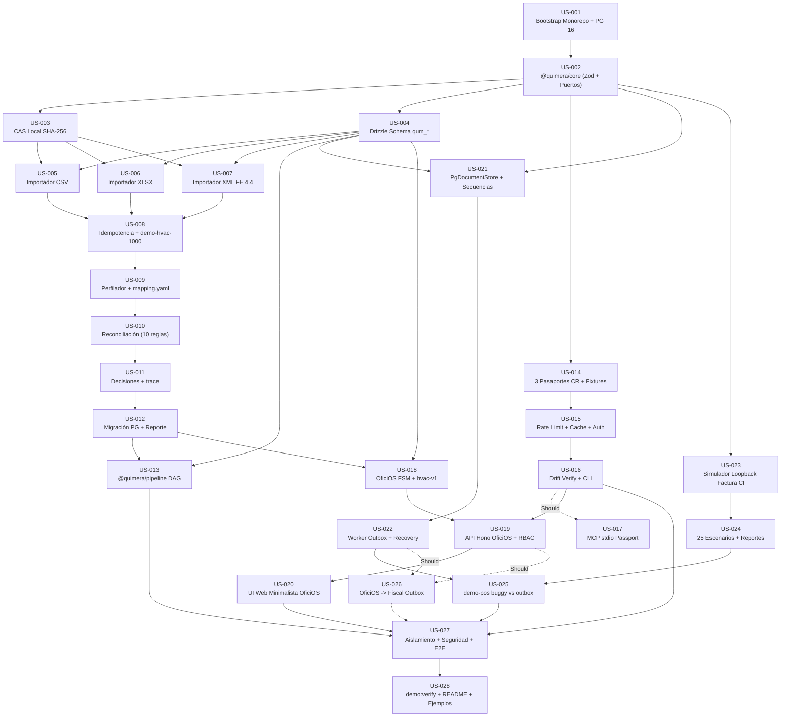

# Grafo de Dependencias (DAG de Desarrollo) — QUIMERA

- **Versión:** 1.0.0
- **Fecha:** 2026-11-21
- **Estado:** Validado contra `implementation-backlog.md`
- **Referencias:** [Backlog](./implementation-backlog.md) | [Plan MVP](./MVP-plan.md)

---

## 1. DAG de Implementación (Slices 1–7)

---

## 2. Análisis del Camino Crítico y Paralelismo

### Camino Crítico (Bloqueante para la Demo E2E)
`US-001` → `US-002` → `US-004` → `US-005/006/007` → `US-008` → `US-009` → `US-010` → `US-011` → `US-012` → `US-018` → `US-019` → `US-020` → `US-027` → `US-028`.

### Tres Carriles Paralelizables Inmediatamente Después de `US-002` (Core)
Si trabajan 2 a 4 personas (o ramas de trabajo independientes):
1. **Carril A (Datos & Pipeline):** `US-003..013` (`Data Exodus` + `Pipeline`).
2. **Carril B (APIs CR):** `US-014..017` (`CR API Passport`) — **cero dependencia de PostgreSQL**.
3. **Carril C (Fiscalidad):** `US-021..025` (`Fiscal Outbox` + `Factura CI` + `demo-pos`) — `US-023/024` tiene **cero dependencia de PostgreSQL**.

### Dependencias Externas y Mitigación de Bloqueos

| Dependencia externa | Dónde afecta | Mitigación para evitar bloqueos |
|---|---|---|
| `@dojocoding/hacienda-sdk@0.13.0` (npm) | `US-007`, `US-021`, `US-022`, `US-024` | Versión fijada en `pnpm-lock.yaml`; verificada en investigación directa |
| `api.hacienda.go.cr` / `apim.bccr.fi.cr` | `US-014`, `US-016` | Todo el desarrollo y pruebas corren contra `fixtures/passports-cr/` en `--mode fixture` (0 bloqueo por red o token) |
| Docker / PostgreSQL 16 local | `US-004` en adelante | `docker-compose.yml` con imagen oficial `postgres:16-alpine` y healthcheck |

### Puntos de Aprobación Humana / Revisión de Arquitectura antes de Avanzar
1. **Compuerta 1 (Fin de `US-002` y `US-004`):** Verificar congelación de contratos `@quimera/core` y DDL `qum_*` antes de abrir los 3 carriles en paralelo.
2. **Compuerta 2 (Fin de `US-012`):** Validar que el dataset `demo-hvac-1000` detecta exactamente `40+12+7+3+1` anomalías y migra limpiamente a `ofi_customers`/`ofi_equipment`.
3. **Compuerta 3 (Fin de `US-025`):** Validar la comparativa en vivo `demo-pos-buggy` vs `demo-pos-outbox` con `Factura CI`.
4. **Compuerta 4 (Pre-producción post-MVP):** Revisión de `QG-07` antes de habilitar certificados reales o entorno `production` de Hacienda.
